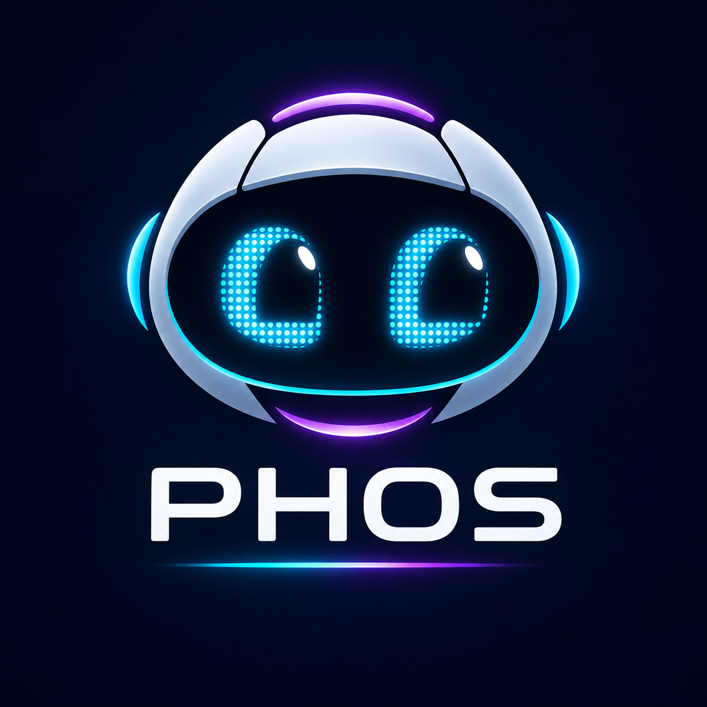
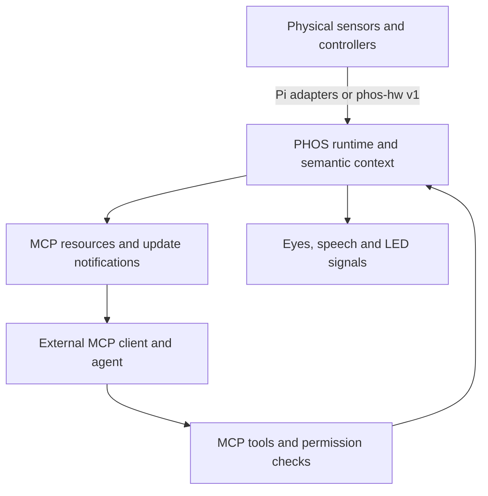

# PHOS

**Bringing AI agents into the physical world.**

**Eyes, voice and senses for AI agents.**

PHOS is **an open-source, bidirectional physical I/O layer for AI agents,
powered by the Model Context Protocol.** Give an existing agent access to
physical context and a way to communicate through expressive eyes, configured
speech, and visual signals—without writing hardware-specific agent integrations.

[](https://github.com/phosairobot/phos/stargazers)
[](LICENSE)
[](https://github.com/phosairobot/phos/actions/workflows/ci.yml?query=branch%3Adev)
[](https://phosairobot.github.io/phos/)
[](pyproject.toml)
[](https://phosairobot.github.io/phos/mcp/)
[](https://www.youtube.com/@phosairobot)

<p align="center">
  
</p>

<p align="center"><em>Bring your own agent. Bring your own hardware.</em></p>

🎥 **See it in action:** Watch hardware demos and animated eye expressions on the [PHOS YouTube Channel (@phosairobot)](https://www.youtube.com/@phosairobot).

Your agent supplies reasoning; PHOS supplies physical perception and execution.
The local runtime targets Raspberry Pi 3 with a 5-inch 800×600 display. Connect
supported peripherals or an optional compatible `phos-hw` v1 controller;
capabilities depend on configured hardware and providers.

**[Connect your first MCP client](docs/developer-quickstart.md)** ·
[How PHOS works](docs/how-phos-works.md) · [Build PHOS](docs/build-phos.md)

## Watch PHOS in Action

| Real-Time Physical Context via MCP | 3-Hour Environmental History Analysis |
| :---: | :---: |
| [](https://www.youtube.com/watch?v=FeNdXLksbAA) | [](https://www.youtube.com/watch?v=KMd93sneYoE) |
| ChatGPT reads available eCO₂, TVOC, temperature, and humidity through MCP without direct hardware access. | An AI agent queries available measurements from a three-hour window of bounded RAM telemetry from ESP32 and Raspberry Pi to analyze trends. |

> Explore more demos and build updates on the [PHOS YouTube Channel (@phosairobot)](https://www.youtube.com/@phosairobot).

## Why PHOS exists

Agents can work with code, documents, and online services. PHOS gives them a
shared interface to selected physical observations and outputs, while the
runtime keeps device access and physical execution local. Developers can build
physically aware experiences; people can see agent activity without continually
checking a chat window.

## Perceive, react, express

- **Perceive:** read environmental measurements, air-quality indicators, motion,
  anonymous presence, attention, and observed expressions with availability
  information. Authorized camera snapshots are on demand.
- **React:** subscription-capable MCP clients receive resource change cues and
  retrieve current context. External host or agent logic decides what happens
  next; PHOS does not automatically activate an LLM.
- **Express:** request supported eye expressions, bounded thinking visuals,
  speech through configured TTS, sleep/wake, or controller-backed LED signals.
  Local gaze and blink behavior make the eyes a non-verbal interface; MCP does
  not expose direct gaze control.
- **Extend:** use hardware adapters or implement the hardware-agnostic
  `phos-hw` v1 controller boundary. ESP32 is the reference controller, not a
  requirement for PHOS.
- **Share with controlled access:** registered agents have independent
  credentials and `observer` or `standard` permission profiles. Multiple clients
  share one runtime and its physical outputs; PHOS is not an agent orchestrator.

## Bidirectional architecture



## MCP integration

PHOS exposes 17 semantic tools and five resources over Streamable HTTP at the
default loopback endpoint `http://127.0.0.1:8001/mcp`. Start with
`phos_get_status` and `phos_get_physical_context`. Resources include
`phos://status`, `phos://physical-context`, `phos://physical-context/assessment`,
`phos://environment`, and the protected JPEG `phos://vision/snapshot`.

For event-driven integrations, compatible clients use `subscriptions/listen`
with `notifications.resourceSubscriptions` under MCP revision `2026-07-28`.
PHOS publishes `notifications/resources/updated` for selected semantic changes;
the client then calls `resources/read`. Notifications are coalesced,
best-effort cues with no replay, not raw telemetry or a historical event stream.
The camera resource has no update notifications.

Native Streamable HTTP clients connect directly. Local stdio clients can use
[phos-mcp-bridge](https://github.com/phosairobot/phos-mcp-bridge), a separately
maintained Node.js 20+ adapter. It reads bearer credentials through
`PHOS_MCP_TOKEN` and does not automatically retry `tools/call`. Client support
for tools, resources, and subscriptions differs: see the
[compatibility guide](docs/mcp-overview.md#client-capabilities-and-transports)
and [full MCP contracts](docs/mcp.md).

## Agent independence and controlled access

Bring a personal, coding, automation, or custom agent through a compatible MCP
client; PHOS does not select its model or reasoning framework. In Web Admin,
register agents and create, rotate, or revoke separate credentials. `observer`
is read-only; `standard` also permits the exposed physical actions, protected
snapshots, and bounded history. Resource reads and actions pass through
`AgentApplicationService` and the shared application services.

The thinking visual uses expiring, identity-owned leases: an agent releases
only its own lease, and local error, sleeping, speaking, and listening states
retain priority. This does not provide exclusive ownership of every output or
coordinate agent tasks. Credentials and permission checks are PHOS features;
MCP alone does not guarantee security. Without configured credential references,
the default bearer mode retains a credential-free compatibility path. Configure
credentials before relying on independent identities. See
[authentication and limits](docs/mcp.md#mcp-authentication-security).

## What you can build

| Experience | PHOS interface | Logic you provide |
| --- | --- | --- |
| Agent activity at a glance | `phos_set_state`, `phos_set_expression` | Map task progress to supported visuals. |
| Coding-agent completion feedback | `phos_signal_user`, `phos_speak` | Detect completion and choose a signal or spoken update; LEDs/audio require setup. |
| Presence-aware interaction | `phos://physical-context` and update cues | Decide whether and when to respond to confirmed presence. |
| Environmental explanations | Current context and bounded history tools | Select measurements and interpret available evidence. |
| Multiple agents, one interface | Separate registered credentials and permission profiles | Coordinate workflows around shared physical outputs. |

These are examples to build with the implemented interfaces, not bundled agent
workflows. See [use cases](docs/use-cases.md).

## PHOS Ecosystem

| Repository | Responsibility |
| --- | --- |
| [phos](https://github.com/phosairobot/phos) | Core Raspberry Pi robot runtime, MCP Streamable HTTP server, REST API, Web Admin, Vision and Voice. |
| [phos-mcp-bridge](https://github.com/phosairobot/phos-mcp-bridge) | Node.js 20+ local `stdio` ↔ remote Streamable HTTP transport for compatible MCP clients; environment-based bearer auth and no automatic `tools/call` retries. |
| [phos-esp32](https://github.com/phosairobot/phos-esp32) | Official ESP32 firmware implementing `phos-hw` v1 serial JSONL for ENS160 + AHT21 telemetry and WS2812B RGB ring control. |

## Hardware architecture and extensibility

The Raspberry Pi runs PHOS; external microcontrollers acquire sensor data and
execute supported controller outputs. `phos-hw` v1 is UTF-8 JSON Lines over
serial, with capability discovery, heartbeats, and reconnect handling. PHOS
maps accepted observations into shared semantic services before exposing them
through MCP. A controller never speaks MCP directly to the agent.

Other boards can implement this protocol, but hardware-agnostic design does not
establish support for arbitrary devices. The reference firmware is ESP32; see
the [controller guide](docs/hardware-controller.md) before developing a port.

Animated eyes, touch reactions, semantic overlays, authenticated Web Admin,
and a service-based REST API complement the MCP interface. Optional speech
supports local Vosk or Cartesia STT and Piper, Cartesia, or ElevenLabs TTS,
with synthesis and playback handled separately. End-to-end LLM conversation
remains future work.

| Tier | Hardware | PHOS support |
| --- | --- | --- |
| Reference / core | Raspberry Pi 3 | Lightweight deployment baseline; automated checks remain hardware-free. |
| Reference / core | Raspberry Pi Camera via Picamera2 | Face, presence, attention, expression, and optional on-demand object-awareness pipeline. Camera features are configured independently. |
| Reference / core | 5-inch 800×600 display | Fullscreen animated face/eyes reference configuration. |
| Optional / external | ESP32 serial controller | Generic `phos-hw` v1 UTF-8 JSON Lines boundary with capability discovery, heartbeat, reconnect, telemetry, and semantic LED commands. Official reference firmware available at [phosairobot/phos-esp32](https://github.com/phosairobot/phos-esp32). |
| Optional / external | WS2812B RGB LED ring | Connected to and driven by the ESP32 via `phos-hw` v1 semantic LED commands. Requires `hardware_controller.enabled: true`, an active serial connection, and advertised LED capability. |
| Optional / external | BME280 / BMP280 | Pi I2C environmental providers: temperature and pressure; BME280 also supplies humidity. Disabled by default. |
| Optional / external | ENS160 + AHT21 | Controller-backed ESP32 telemetry for estimated eCO2, TVOC, AQI-UBA, temperature, and humidity—not direct Pi I2C polling. Disabled by default. |
| Optional / external | MPU6050 / GY-521 | Pi I2C six-axis motion provider and interpreted motion path. Disabled by default. |

Read the [hardware guide](docs/hardware.md) before
connecting a build. In particular, ENS160 eCO2 is an estimated equivalent, not
direct NDIR CO2.

Choose parts with the [Hardware BOM](docs/hardware-bom.md), from the core display
setup to optional audio, sensors, and an ESP32 controller.

## Quick start

**Already running PHOS?** Follow [Connect your first MCP client](docs/developer-quickstart.md):
configure agent credentials, connect a compatible client, discover capabilities,
and read status or physical context before requesting an action.

**Building a new installation?** Use the following Raspberry Pi setup, then
continue to the same client guide.


The installer targets Debian-based Raspberry Pi OS on `armv7l` or `aarch64`. It
installs required OS packages, creates `.venv` with system site packages,
installs `.[all]`, downloads the verified local expression ONNX model, and runs
a smoke check.

```bash
git clone https://github.com/phosairobot/phos.git
cd phos
git switch dev
./scripts/install-phos.sh
```

Review and edit the canonical runtime configuration before enabling optional
hardware or network listeners:

```bash
nano config/phos.yaml
PYTHONPATH=src .venv/bin/python -m robot.main --config config/phos.yaml
```

Run this from the Pi's local graphical desktop. Face tracking, expression
inference, camera preview, NanoDet, sensors, the external controller, voice/TTS,
and Web Admin are disabled in the committed configuration. MCP is enabled on
loopback with bearer mode selected. Use the [MCP setup guide](docs/developer-quickstart.md)
to configure agent access and credentials before connecting clients; keep all
secrets outside `config/phos.yaml`.

NanoDet needs a compatible local ONNX model and explicit
`object_awareness.enabled`/`model_path` configuration; the installer prepares
the expression model only. Sensor setup requires the selected I2C interface,
wiring, and address, or the [official ESP32 firmware](https://github.com/phosairobot/phos-esp32) and serial
permissions. Voice needs audio devices and the selected local models or cloud
credentials. Follow the [installation reference](docs/installation.md) for each
opt-in feature.

That foreground command is the supported diagnostic launch. For a graphical
Pi deployment, install the supplied user service following the
[managed-startup instructions](docs/installation.md#managed-startup-and-browser-restart);
the service starts the same `python -m robot.main` entry point. `run_pi.sh` is a
developer deployment helper with a fixed remote host, not the local robot
launcher.

For hardware-free development checks, use Python directly—there are currently
no `make test` or `make lint` targets:

```bash
python3.11 -m venv .venv
.venv/bin/python -m pip install -e '.[web,mcp,aws,voice]' pytest numpy
.venv/bin/python -m pytest -q
```

The Makefile provides `make openapi` to regenerate the API specification; run
it with the virtual environment activated. CI also compiles Python sources and
builds documentation with `mkdocs build --strict` after installing
`requirements-docs.txt`.

MCP support requires Python 3.11 or newer; the base package supports Python
3.9+. The [installation guide](docs/installation.md) covers display, camera,
I2C, voice, Web Admin, controller, and service prerequisites.

## Repository structure

| Path | Purpose |
| --- | --- |
| `src/robot/` | Python package: core/runtime, application services, MCP, Web Admin/API, hardware adapters, vision, UI, voice, and AI interfaces. |
| `config/` | Canonical non-secret runtime configuration (`phos.yaml`). |
| `scripts/` | Raspberry Pi installer, CI validation, diagnostics, and focused utilities. |
| `tests/` | Hardware-free automated regression suite. |
| `docs/` | MkDocs source for architecture, build, setup, MCP, and reference documentation. |
| `phos-protocol-test/` | Manual/standalone serial protocol test utilities. |

## Standalone mode and personalization

PHOS also runs without an external agent. The same local runtime manages eyes,
touch gestures, configured sensor reactions, finite voice sessions,
deterministic English/Italian commands, and optional Web Admin and REST access.
It is required in both standalone and agent-connected operation. End-to-end
local LLM conversation remains future work.

Personalize eyes, colors, and appearance through
[skins](docs/appearance/creating-skins.md). These complement the physical
communication interface. See [standalone operation](docs/discover.md#standalone-operation)
and the [roadmap](docs/roadmap.md).

## Documentation & contributing

- [Documentation site](https://phosairobot.github.io/phos/) · [installation](https://phosairobot.github.io/phos/installation/) · [architecture](https://phosairobot.github.io/phos/architecture/) · [hardware](https://phosairobot.github.io/phos/hardware/)
- [MCP integration](https://phosairobot.github.io/phos/mcp-overview/) · [MCP reference](https://phosairobot.github.io/phos/mcp/) · [development and testing](https://phosairobot.github.io/phos/development/)
- [Contributing](CONTRIBUTING.md) · [trademark guidance](TRADEMARKS.md) · [NOTICE](NOTICE)
- [YouTube Channel](https://www.youtube.com/@phosairobot) — hardware demos and build updates
- [phos-esp32 Firmware](https://github.com/phosairobot/phos-esp32) — official companion firmware for the external controller
- [phos-mcp-bridge](https://github.com/phosairobot/phos-mcp-bridge) — recommended transport adapter for local `stdio` MCP clients

Build an external agent example, a subscription-capable client integration, a
compatible controller implementation, or a physical interaction experience.
Contributions to sensor adapters, visual communication, accessibility, and
documentation are also welcome. See [contribution opportunities](docs/contributing.md). Please read [CONTRIBUTING.md](CONTRIBUTING.md),
[architecture decisions](docs/decisions.md), and [AGENTS.md](AGENTS.md) before
opening a change. Keep credentials, raw camera frames, and audio recordings out
of issues and pull requests.

## Support the Project

⭐ **[Star the repository](https://github.com/phosairobot/phos)** to help other
makers and developers discover PHOS. Share your hardware build, wiring lessons,
or a focused feature proposal in an [Issue](https://github.com/phosairobot/phos/issues).
Hardware validation reports and documentation improvements are welcome too.

## License

PHOS is licensed under the [Apache License, Version 2.0](LICENSE). Third-party
license information is tracked in the [license audit](docs/LICENSE_AUDIT.md).
See [NOTICE](NOTICE) for notices and [TRADEMARKS.md](TRADEMARKS.md) for the draft
name and logo guidance.
