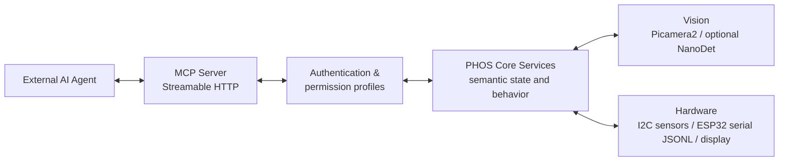

# PHOS

**An open-source Raspberry Pi robot that gives AI agents safe, structured physical context through MCP.**

[](LICENSE)
[](https://github.com/phosairobot/phos/actions/workflows/ci.yml)
[](https://phosairobot.github.io/phos/)
[](pyproject.toml)
[](docs/mcp.md)

<p align="center">
  
</p>

<p align="center"><em>PHOS pairs an expressive local presence with a deliberately bounded interface for external agents.</em></p>

PHOS keeps perception, device ownership, and safety decisions on the robot. An
authorized external agent can then reason over structured context and request
bounded semantic actions—without receiving a GPIO handle or an unrestricted
camera feed. The reference target is a Raspberry Pi 3 with a 5-inch 800×600
display; physical acceptance remains build-specific.

## Why PHOS?

- **Local hardware, external reasoning.** PHOS owns its camera, display,
  sensors, lifecycle, and behavior boundaries; agents use application services,
  not device drivers.
- **Least-privilege MCP access.** Per-agent permission profiles gate semantic
  operations such as `read_perception`, `read_physical_history`, and
  `read_camera_snapshot`, as well as explicitly authorized controls.
- **Bounded context, not surveillance.** Accepted environmental measurements
  and physical transitions are kept only in RAM, for up to six hours, with
  fixed limits; they disappear on restart.
- **Privacy-oriented vision defaults.** There is no continuous video stream.
  The camera snapshot Resource is on demand and permission-controlled; optional
  NanoDet object awareness is disabled by default and returns bounded labels,
  confidence, and freshness rather than frames, boxes, identities, or tracking.

## Architecture & MCP flow



The Streamable HTTP endpoint is configured at `/mcp` (default:
`http://127.0.0.1:8001/mcp`). It exposes 17 semantic tools, including status,
physical context and assessment, perception, snapshot, expression/state,
speech, sleep/wake, signaling, and bounded history queries. Its five Resources
are `phos://status`, `phos://physical-context`,
`phos://physical-context/assessment`, `phos://environment`, and the
permission-controlled JPEG `phos://vision/snapshot`. See the [MCP reference](docs/mcp.md)
for the complete contracts, authentication modes, and limits.

## Key features & supported hardware

| Tier | Hardware | PHOS support |
| --- | --- | --- |
| Reference / core | Raspberry Pi 3+ | Lightweight deployment baseline; automated checks remain hardware-free. |
| Reference / core | Raspberry Pi Camera via Picamera2 | Face, presence, attention, expression, and optional on-demand object-awareness pipeline. Camera features are configured independently. |
| Reference / core | 5-inch 800×600 display | Fullscreen animated face/eyes reference configuration. |
| Optional / external | ESP32 serial controller | Generic `phos-hw` v1 UTF-8 JSON Lines boundary with capability discovery, heartbeat, reconnect, telemetry, and semantic LED commands. Firmware is not included in this repository. |
| Optional / external | BME280 / BMP280 | Pi I2C environmental providers: temperature and pressure; BME280 also supplies humidity. Disabled by default. |
| Optional / external | ENS160 + AHT21 | Controller-backed ESP32 telemetry for estimated eCO2, TVOC, AQI-UBA, temperature, and humidity—not direct Pi I2C polling. Disabled by default. |
| Optional / external | MPU6050 / GY-521 | Pi I2C six-axis motion provider and interpreted motion path. Disabled by default. |

The optional hardware adapters are implemented, but software support is not a
claim that a particular breakout, enclosure, power arrangement, or wiring has
been physically accepted. Read the [hardware guide](docs/hardware.md) before
connecting a build. In particular, ENS160 eCO2 is an estimated equivalent, not
direct NDIR CO2.

## Quick start

The installer targets Debian-based Raspberry Pi OS on `armv7l` or `aarch64`. It
installs required OS packages, creates `.venv` with system site packages,
installs `.[all]`, downloads the verified local expression ONNX model, and runs
a smoke check.

```bash
git clone https://github.com/phosairobot/phos.git
cd phos
git switch dev
./scripts/install-phos.sh
```

Review and edit the canonical runtime configuration before enabling optional
hardware or network listeners:

```bash
nano config/phos.yaml
PYTHONPATH=src .venv/bin/python -m robot.main --config config/phos.yaml
```

That foreground command is the supported diagnostic launch. For a graphical
Pi deployment, install the supplied user service following the
[managed-startup instructions](docs/installation.md#managed-startup-and-browser-restart);
the service starts the same `python -m robot.main` entry point. `run_pi.sh` is a
developer deployment helper with a fixed remote host, not the local robot
launcher.

For hardware-free development checks, use Python directly—there are currently
no `make test` or `make lint` targets:

```bash
python3 -m venv .venv
.venv/bin/python -m pip install -e '.[web,mcp,aws,voice]' pytest
.venv/bin/python -m pytest -q
make openapi
```

MCP support requires Python 3.11 or newer; the base package supports Python
3.9+. The [installation guide](docs/installation.md) covers display, camera,
I2C, voice, Web Admin, controller, and service prerequisites.

## Repository structure

| Path | Purpose |
| --- | --- |
| `src/robot/` | Python package: core/runtime, application services, MCP, Web Admin/API, hardware adapters, vision, UI, voice, and AI interfaces. |
| `config/` | Canonical non-secret runtime configuration (`phos.yaml`). |
| `scripts/` | Raspberry Pi installer, CI validation, diagnostics, and focused utilities. |
| `tests/` | Hardware-free automated regression suite. |
| `docs/` | MkDocs source for architecture, build, setup, MCP, and reference documentation. |
| `phos-protocol-test/` | Manual/standalone serial protocol test utilities. |

## Roadmap

- [x] Expressive 800×600 face, semantic visual state, and manual expressions.
- [x] Picamera2-based face/presence/attention pipeline and local/AWS expression-provider architecture.
- [x] Streamable HTTP MCP server with semantic tools, Resources, permissions, and configured bearer credentials.
- [x] Bounded RAM-only physical-context history and opt-in, on-demand NanoDet object awareness.
- [x] `phos-hw` v1 controller protocol plus optional environmental, air-quality, IMU, and semantic LED integrations.
- [x] Voice capture/STT foundation, deterministic English/Italian interaction commands, and provider-neutral TTS/playback.
- [ ] Complete Raspberry Pi physical acceptance for the display, camera, optional sensors, LED ring, and controller configurations.
- [ ] Publish/reference matching ESP32 firmware and complete external-controller hardware acceptance.
- [ ] Complete external multi-agent MCP interoperability validation.
- [ ] Add the planned LLM resolver, language detection, wake word, and continuous listening; evaluate Home Assistant as a permissioned integration layer.

See the [roadmap](docs/roadmap.md) and [current implementation state](docs/current-state.md)
for milestone detail and the distinction between implemented software and
physical validation.

## Documentation, contributing & license

- [Documentation site](https://phosairobot.github.io/phos/) · [installation](docs/installation.md) · [architecture](docs/architecture.md) · [hardware](docs/hardware.md)
- [MCP integration](docs/mcp-overview.md) · [MCP reference](docs/mcp.md) · [development and testing](docs/development.md)
- [Contributing](CONTRIBUTING.md) · [trademark guidance](TRADEMARKS.md) · [NOTICE](NOTICE)

Contributions from makers, documentation writers, hardware testers, and Python
developers are welcome. Please read [CONTRIBUTING.md](CONTRIBUTING.md),
[architecture decisions](docs/decisions.md), and [AGENTS.md](AGENTS.md) before
opening a change. Keep credentials, raw camera frames, and audio recordings out
of issues and pull requests.

PHOS is licensed under the [Apache License, Version 2.0](LICENSE). Third-party
license information is tracked in the [license audit](docs/LICENSE_AUDIT.md).
