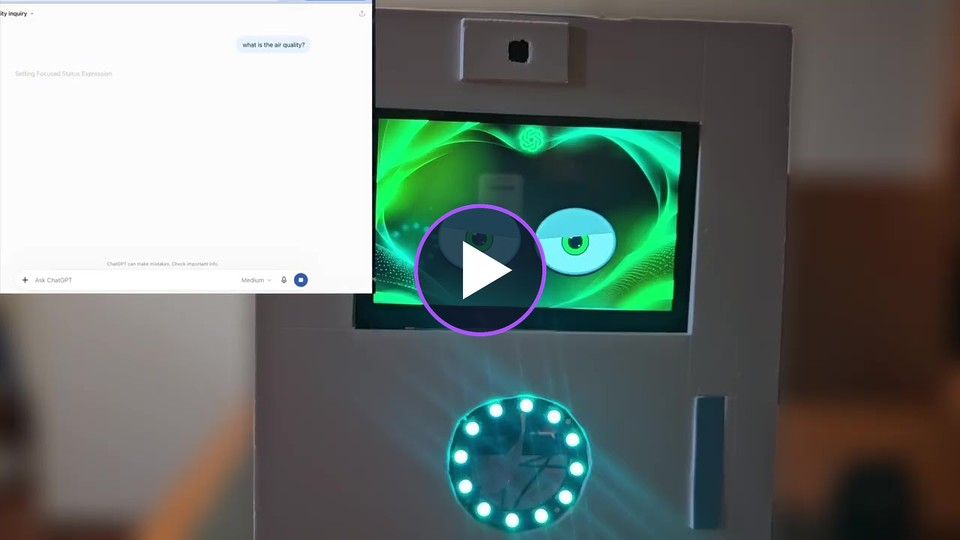
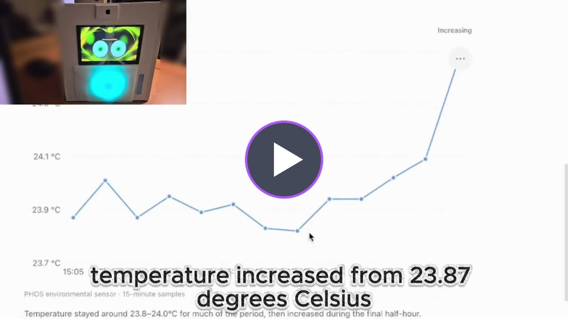
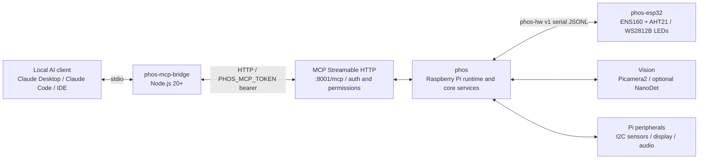

# PHOS

**An open-source Raspberry Pi robot that gives AI agents safe, structured physical context through MCP.**

[](https://github.com/phosairobot/phos/stargazers)
[](LICENSE)
[](https://github.com/phosairobot/phos/actions/workflows/ci.yml?query=branch%3Adev)
[](https://phosairobot.github.io/phos/)
[](pyproject.toml)
[](https://phosairobot.github.io/phos/mcp/)
[](https://www.youtube.com/@phosairobot)

<p align="center">
  
</p>

<p align="center"><em>PHOS pairs an expressive local presence with a deliberately bounded interface for external agents.</em></p>

🎥 **See it in action:** Watch hardware demos and animated eye expressions on the [PHOS YouTube Channel (@phosairobot)](https://www.youtube.com/@phosairobot).

PHOS keeps perception, device ownership, and safety decisions on the robot. An
authorized external agent can then reason over structured context and request
bounded semantic actions—without receiving a GPIO handle or an unrestricted
camera feed. The reference target is a Raspberry Pi 3 with a 5-inch 800×600
display.

> [!TIP]
> **Building an AI robot or exploring MCP for physical hardware?** Give PHOS a ⭐ **[Star on GitHub](https://github.com/phosairobot/phos)** to follow new hardware providers, sensor integrations, and [official ESP32 firmware](https://github.com/phosairobot/phos-esp32) updates!

## Watch PHOS in Action

| Real-Time Physical Context via MCP | 3-Hour Environmental History Analysis |
| :---: | :---: |
| [](https://www.youtube.com/watch?v=FeNdXLksbAA) | [](https://www.youtube.com/watch?v=KMd93sneYoE) |
| ChatGPT reads available eCO₂, TVOC, temperature, and humidity through MCP without direct hardware access. | An AI agent queries available measurements from a three-hour window of bounded RAM telemetry from ESP32 and Raspberry Pi to analyze trends. |

> Explore more demos and build updates on the [PHOS YouTube Channel (@phosairobot)](https://www.youtube.com/@phosairobot).

## Why PHOS?

- **Local hardware, external reasoning.** PHOS owns its camera, display,
  sensors, lifecycle, and behavior boundaries; agents use application services,
  not device drivers.
- **Least-privilege MCP access.** Per-agent permission profiles gate semantic
  operations such as `read_perception`, `read_physical_history`, and
  `read_camera_snapshot`, as well as explicitly authorized controls.
- **Bounded context, not surveillance.** Accepted environmental measurements
  and physical transitions are kept only in RAM, for up to six hours, with
  fixed limits; they disappear on restart.
- **Privacy-oriented vision defaults.** There is no continuous video stream.
  The camera snapshot Resource is on demand and permission-controlled; optional
  NanoDet object awareness is disabled by default and returns bounded labels,
  confidence, and freshness rather than frames, boxes, identities, or tracking.

## Architecture & MCP flow



The bridge adapts local `stdio` clients to the remote PHOS endpoint. It receives
bearer credentials through `PHOS_MCP_TOKEN`, never CLI flags, and never
automatically retries `tools/call`, preventing duplicate physical actions after
an uncertain response. Clients supporting Streamable HTTP can connect directly.

The Streamable HTTP endpoint is configured at `/mcp` (default:
`http://127.0.0.1:8001/mcp`). It exposes 17 semantic tools, including status,
physical context and assessment, perception, snapshot, expression/state,
speech, sleep/wake, signaling, and bounded history queries. Its five Resources
are `phos://status`, `phos://physical-context`,
`phos://physical-context/assessment`, `phos://environment`, and the
permission-controlled JPEG `phos://vision/snapshot`. See the [MCP reference](docs/mcp.md)
for the complete contracts, authentication modes, and limits.

## PHOS Ecosystem

| Repository | Responsibility |
| --- | --- |
| [phos](https://github.com/phosairobot/phos) | Core Raspberry Pi robot runtime, MCP Streamable HTTP server, REST API, Web Admin, Vision and Voice. |
| [phos-mcp-bridge](https://github.com/phosairobot/phos-mcp-bridge) | Node.js 20+ local `stdio` ↔ remote Streamable HTTP transport for Claude Desktop, Claude Code, Cursor and other MCP clients; environment-based bearer auth and no automatic `tools/call` retries. |
| [phos-esp32](https://github.com/phosairobot/phos-esp32) | Official ESP32 firmware implementing `phos-hw` v1 serial JSONL for ENS160 + AHT21 telemetry and WS2812B RGB ring control. |

## Key features & supported hardware

Animated eyes, touch reactions, semantic overlays, authenticated Web Admin,
and a service-based REST API complement the MCP interface. Optional speech
supports local Vosk or Cartesia STT and Piper, Cartesia, or ElevenLabs TTS,
with synthesis and playback handled separately. End-to-end LLM conversation
remains future work.

| Tier | Hardware | PHOS support |
| --- | --- | --- |
| Reference / core | Raspberry Pi 3+ | Lightweight deployment baseline; automated checks remain hardware-free. |
| Reference / core | Raspberry Pi Camera via Picamera2 | Face, presence, attention, expression, and optional on-demand object-awareness pipeline. Camera features are configured independently. |
| Reference / core | 5-inch 800×600 display | Fullscreen animated face/eyes reference configuration. |
| Optional / external | ESP32 serial controller | Generic `phos-hw` v1 UTF-8 JSON Lines boundary with capability discovery, heartbeat, reconnect, telemetry, and semantic LED commands. Official reference firmware available at [phosairobot/phos-esp32](https://github.com/phosairobot/phos-esp32). |
| Optional / external | WS2812B RGB LED ring | Connected to and driven by the ESP32 via `phos-hw` v1 semantic LED commands. Requires `hardware_controller.enabled: true`, an active serial connection, and advertised LED capability. |
| Optional / external | BME280 / BMP280 | Pi I2C environmental providers: temperature and pressure; BME280 also supplies humidity. Disabled by default. |
| Optional / external | ENS160 + AHT21 | Controller-backed ESP32 telemetry for estimated eCO2, TVOC, AQI-UBA, temperature, and humidity—not direct Pi I2C polling. Disabled by default. |
| Optional / external | MPU6050 / GY-521 | Pi I2C six-axis motion provider and interpreted motion path. Disabled by default. |

Read the [hardware guide](docs/hardware.md) before
connecting a build. In particular, ENS160 eCO2 is an estimated equivalent, not
direct NDIR CO2.

Choose parts with the [Hardware BOM](docs/hardware-bom.md), from the core display
setup to optional audio, sensors, and an ESP32 controller.

## Quick start

The installer targets Debian-based Raspberry Pi OS on `armv7l` or `aarch64`. It
installs required OS packages, creates `.venv` with system site packages,
installs `.[all]`, downloads the verified local expression ONNX model, and runs
a smoke check.

```bash
git clone https://github.com/phosairobot/phos.git
cd phos
git switch dev
./scripts/install-phos.sh
```

Review and edit the canonical runtime configuration before enabling optional
hardware or network listeners:

```bash
nano config/phos.yaml
PYTHONPATH=src .venv/bin/python -m robot.main --config config/phos.yaml
```

Run this from the Pi's local graphical desktop. Face tracking, expression
inference, camera preview, NanoDet, sensors, the external controller, voice/TTS,
and Web Admin are disabled in the committed configuration. MCP is enabled on
loopback with bearer mode selected. Use the [MCP setup guide](docs/developer-quickstart.md)
to configure agent access and credentials before connecting clients; keep all
secrets outside `config/phos.yaml`.

NanoDet needs a compatible local ONNX model and explicit
`object_awareness.enabled`/`model_path` configuration; the installer prepares
the expression model only. Sensor setup requires the selected I2C interface,
wiring, and address, or the [official ESP32 firmware](https://github.com/phosairobot/phos-esp32) and serial
permissions. Voice needs audio devices and the selected local models or cloud
credentials. Follow the [installation reference](docs/installation.md) for each
opt-in feature.

That foreground command is the supported diagnostic launch. For a graphical
Pi deployment, install the supplied user service following the
[managed-startup instructions](docs/installation.md#managed-startup-and-browser-restart);
the service starts the same `python -m robot.main` entry point. `run_pi.sh` is a
developer deployment helper with a fixed remote host, not the local robot
launcher.

For hardware-free development checks, use Python directly—there are currently
no `make test` or `make lint` targets:

```bash
python3.11 -m venv .venv
.venv/bin/python -m pip install -e '.[web,mcp,aws,voice]' pytest numpy
.venv/bin/python -m pytest -q
```

The Makefile provides `make openapi` to regenerate the API specification; run
it with the virtual environment activated. CI also compiles Python sources and
builds documentation with `mkdocs build --strict` after installing
`requirements-docs.txt`.

MCP support requires Python 3.11 or newer; the base package supports Python
3.9+. The [installation guide](docs/installation.md) covers display, camera,
I2C, voice, Web Admin, controller, and service prerequisites.

## Repository structure

| Path | Purpose |
| --- | --- |
| `src/robot/` | Python package: core/runtime, application services, MCP, Web Admin/API, hardware adapters, vision, UI, voice, and AI interfaces. |
| `config/` | Canonical non-secret runtime configuration (`phos.yaml`). |
| `scripts/` | Raspberry Pi installer, CI validation, diagnostics, and focused utilities. |
| `tests/` | Hardware-free automated regression suite. |
| `docs/` | MkDocs source for architecture, build, setup, MCP, and reference documentation. |
| `phos-protocol-test/` | Manual/standalone serial protocol test utilities. |

## Roadmap

- [x] Expressive 800×600 face, semantic visual state, and manual expressions.
- [x] Picamera2-based face/presence/attention pipeline and local/AWS expression-provider architecture.
- [x] Streamable HTTP MCP server with semantic tools, Resources, permissions, and configured bearer credentials.
- [x] Bounded RAM-only physical-context history and opt-in, on-demand NanoDet object awareness.
- [x] `phos-hw` v1 controller protocol plus optional environmental, air-quality, IMU, and semantic LED integrations.
- [x] Voice capture/STT foundation, deterministic English/Italian interaction commands, and provider-neutral TTS/playback.
- [x] Complete Raspberry Pi hardware integration and field testing for the display, camera, optional sensors, LED ring, and controller configurations.
- [x] Publish reference ESP32 firmware at [phosairobot/phos-esp32](https://github.com/phosairobot/phos-esp32) implementing the `phos-hw v1` protocol.
- [ ] Complete external multi-agent MCP interoperability validation.
- [ ] Add the planned LLM resolver, language detection, wake word, and continuous listening; evaluate Home Assistant as a permissioned integration layer.

See the [roadmap](docs/roadmap.md) and [current implementation state](docs/current-state.md)
for milestone detail and the distinction between implemented software and
hardware integration tests.

## Documentation & contributing

- [Documentation site](https://phosairobot.github.io/phos/) · [installation](https://phosairobot.github.io/phos/installation/) · [architecture](https://phosairobot.github.io/phos/architecture/) · [hardware](https://phosairobot.github.io/phos/hardware/)
- [MCP integration](https://phosairobot.github.io/phos/mcp-overview/) · [MCP reference](https://phosairobot.github.io/phos/mcp/) · [development and testing](https://phosairobot.github.io/phos/development/)
- [Contributing](CONTRIBUTING.md) · [trademark guidance](TRADEMARKS.md) · [NOTICE](NOTICE)
- [YouTube Channel](https://www.youtube.com/@phosairobot) — hardware demos and build updates
- [phos-esp32 Firmware](https://github.com/phosairobot/phos-esp32) — official companion firmware for the external controller
- [phos-mcp-bridge](https://github.com/phosairobot/phos-mcp-bridge) — recommended transport adapter for local `stdio` MCP clients

Contributions from makers, documentation writers, hardware testers, and Python
developers are welcome. Please read [CONTRIBUTING.md](CONTRIBUTING.md),
[architecture decisions](docs/decisions.md), and [AGENTS.md](AGENTS.md) before
opening a change. Keep credentials, raw camera frames, and audio recordings out
of issues and pull requests.

## Support the Project

⭐ **[Star the repository](https://github.com/phosairobot/phos)** to help other
makers and developers discover PHOS. Share your hardware build, wiring lessons,
or a focused feature proposal in an [Issue](https://github.com/phosairobot/phos/issues).
Hardware validation reports and documentation improvements are welcome too.

## License

PHOS is licensed under the [Apache License, Version 2.0](LICENSE). Third-party
license information is tracked in the [license audit](docs/LICENSE_AUDIT.md).
See [NOTICE](NOTICE) for notices and [TRADEMARKS.md](TRADEMARKS.md) for the draft
name and logo guidance.
