# PHOS Architecture

## High-level model

## Remote application boundary

Remote control is mediated by `robot.services.PhosApplicationService`. REST,
Web Admin, event-stream, and future MCP/Voice adapters use semantic commands
and read models from this boundary; they do not access camera, GPIO, I2C
sensors, LED providers, or renderer internals. The service delegates state
changes to `RobotCore`/`BehaviorEngine` and configuration work to lifecycle.

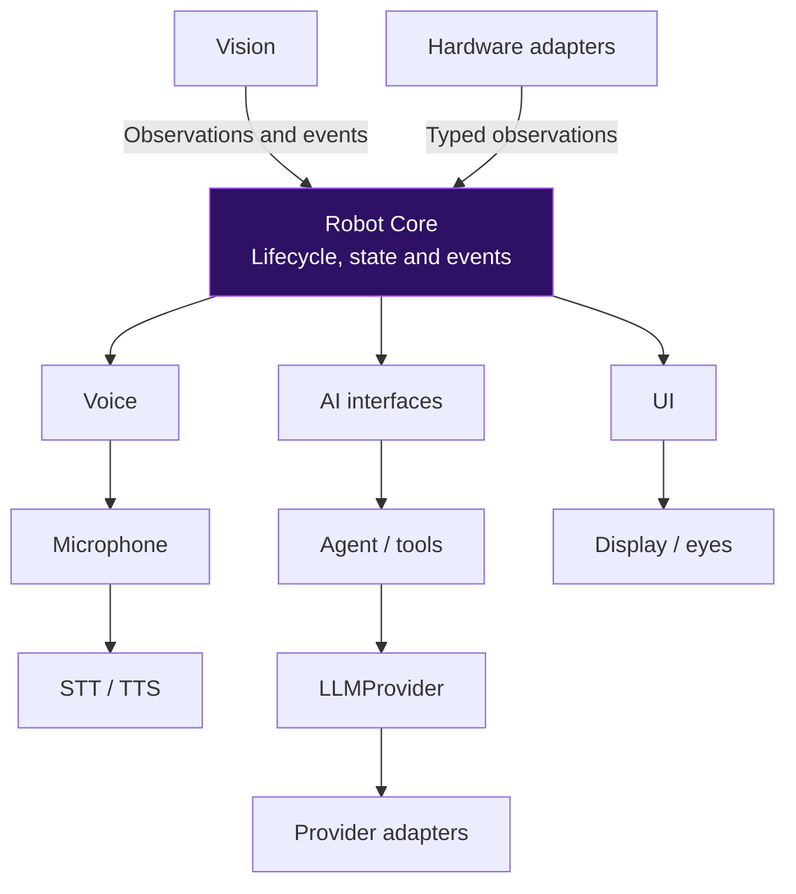

## Core principles

### External Hardware Controller Protocol v1

PHOS defines a hardware-agnostic USB/serial controller boundary in
`robot.hardware.controller_protocol`; it is not an ESP32 protocol. It uses
UTF-8 JSON Lines, one bounded object per newline, with the envelope
`protocol: "phos-hw"`, `version: 1`, `type`, optional `id`/`reply_to` and
object `payload`. Controllers push semantic sensor/motion events and advertise
capabilities; PHOS does not poll them. The v1 source currently specifies the
payload only where PHOS consumes it: `motion_update`, `orientation_update`,
and `set_led_animation` have strict payload validation; the serial adapter also
maps `sensor_update` temperature (`c`), pressure (`hpa`), humidity (`%`), eCO2
(`ppm`), TVOC (`ppb`), and the push proof
(`{"sensor":"push","event":"pressed"}`) into existing semantic services.
`capabilities` remains controller-defined metadata; LED output is available
only for the active serial session when that metadata advertises LED support.
Other recognized v1 event types are retained as diagnostics but have no
Raspberry semantic mapping yet. PHOS currently transmits only
`request_capabilities`, `ping`, and resolved `set_led_animation` commands;
the remaining accepted command names are reserved protocol vocabulary, not Web
or API controls. Commands cover bounded LED animations (`off`, `solid`,
`blink`, `pulse`, `breathe`, `chase`, `spin`, `wipe`). Breathe accepts color,
brightness, period/duration and min/max intensity. Controllers execute timing,
but never invent PHOS semantics. Heartbeats use reconnectable transports; a
stale peer is unhealthy. PHOS treats LED output as unavailable for that session;
any controller-local LED fallback is firmware-owned. Unknown top-level fields
are ignored, while unknown types and versions receive bounded protocol errors.
Sensor events must still enter existing semantic services and BehaviorEngine
ownership. The Raspberry Pi serial adapter is reconnectable and configured
with a manual device path.

Directional LED fields are protocol semantics, not physical LED indexes.
`spin` is circular and defaults to clockwise; it accepts only clockwise or
counterclockwise direction. `chase` and `wipe` default to circular/clockwise;
their circular form accepts clockwise/counterclockwise direction (`wipe` may
also name a top/bottom/left/right origin). Their symmetric form requires an
origin plus outward or inward direction. `off`, `solid`, `blink`, `pulse` and
`breathe` reject all directional fields. Top, bottom, left and right are logical
positions: each controller implementation owns its physical index mapping and
must preserve these v1 defaults for payloads that omit the new optional fields.

For the initial inbound proof, a controller pushes
`sensor_update` with `{"sensor":"push","event":"pressed"}`. PHOS maps this
to its existing completed touch/tap semantic boundary; it does not poll the
controller or add controller-specific behavior logic.

For controller-backed sensors, set `hardware_controller.enabled: true` and the
corresponding canonical `sensors.environmental.provider`,
`sensors.ens160.provider`, or `sensors.imu.provider` to `controller`, while
retaining `enabled: true`. This prevents local I2C workers from starting while
controller `sensor_update` messages update the same semantic snapshots used by
the application services. The controller is a generic provider, not a hardware
vendor identity. The committed default remains `local` and does not enable
optional controller hardware.

Controller IMU telemetry uses two validated v1 messages. `motion_update` has
exactly `{"state": "stationary|moving|tilt_left|tilt_right|tilt_forward|tilt_backward|shake|impact", "intensity": "low|medium|high"}`;
intensity is semantic movement intensity, never linear velocity. `orientation_update`
has exactly `acceleration_m_s2` and `angular_velocity_dps` vectors, each with
finite numeric `x`, `y`, and `z` axes (m/s² and degrees/second respectively).
Both update the existing IMU service; semantic motion and telemetry remain
independent snapshot fields.

### Transient semantic overlays

`SemanticOverlayService` owns bounded, source-scoped presentation requests:
`success`, `info`, `attention`, `warning`, `error`, and `sensor_alert`. Each
source owns one request; replacement affects only that source. Requests are
plain-text (maximum 120 characters), expire on monotonic time, and resolve by
priority from highest to lowest as shown below. Equal-priority requests resolve
to the newest request.

The renderer receives only an
immutable visible intent/message view, never caller-supplied drawing details.
The existing interpreted air-quality warning/bad event is the only automatic
v1 sensor source; it requests `sensor_alert` without inspecting raw providers.

This system is internal to the application-service boundary in v1: it adds no
REST endpoint. It is independent of `RobotState`, `FaceState`, environmental
markers, and state effects. The compact semantic card renders after camera
preview but before the final local administrative layer. Recovery and Admin QR
overlays therefore remain secret-bearing system overlays above it, retain their
existing touch behavior, and are not dismissible by semantic requests.

### Semantic Physical Context

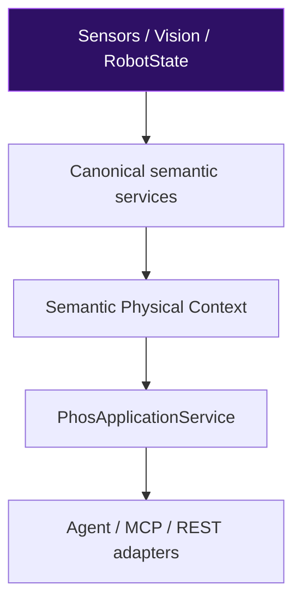

`SemanticPhysicalContext` is a read-only, build-on-read perception model. It
combines canonical robot, environmental, air-quality, motion, presence,
attention, and observed-expression semantics. Each section preserves its own
availability and freshness state, so partial context remains useful. It exposes
no provider/device identity, raw camera data, identity, renderer state, LED
state, or controller health. It adds no REST endpoint or MCP adapter;
`/api/v1/status` remains the broader operational status contract.

### Minimal Agent Permission Model

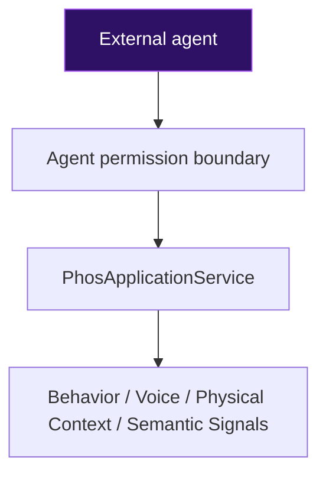

`AgentApplicationService` is a small, provider-independent facade for future
trusted agent adapters.  It checks an immutable `AgentAccess` set before
delegating to the existing `PhosApplicationService`; it never grants access to
providers, renderers, controller transports, or configuration internals.  The
canonical operation mapping is:

| Operation | Permission |
| --- | --- |
| `status` | `READ_STATUS` |
| `get_physical_context` | `READ_PHYSICAL_CONTEXT` |
| `presence`, `attention`, `observed_expression` | `READ_PERCEPTION` |
| `set_expression` | `CONTROL_EXPRESSION` |
| `speak` | `CONTROL_VOICE` |
| `sleep`, `wake` | `CONTROL_SLEEP` |
| `signal_user` | `SIGNAL_USER` |
| `set_visual_state` | `CONTROL_VISUAL_STATE` |

Sleep and wake
remain normal state transitions; a signal remains subject to existing semantic
LED arbitration.

An agent visual-state request is an identity-scoped, expiring presentation lease,
not a lifecycle transition: only `thinking` may be acquired and `idle` releases
the caller's lease. The effective visual state preserves Core priority for error,
sleeping, speaking, and listening, and never mutates `RobotCore.state`.

The in-code `standard` profile contains that explicit complete v1 set; the
`observer` profile contains only the three read permissions.  No profile is
persisted or selected from configuration yet.  Raw LED animation, renderer and
camera-frame access, serial/controller transport, hardware/configuration
mutation, and administrative/recovery controls are intentionally absent from
this facade.

Permission answers whether an identity may request an operation. Capability
answers whether the delegated application service can currently perform it;
validation, availability, lifecycle, and arbitration errors still come from
that service after a permission check. Authentication answers who is calling:
MCP Stage 3.1 resolves one immutable provider-neutral `AgentIdentity` per
inbound request before constructing the identity-bound agent facade. The
transitional local authenticator resolves the existing trusted-local client to
the `standard` profile without credential verification. This is not a complete
security boundary: credential-backed transport authentication, persisted
identities, network authorization, OS permissions, and sandboxing remain
separate concerns.

### MCP Semantic Adapter — Stage 1

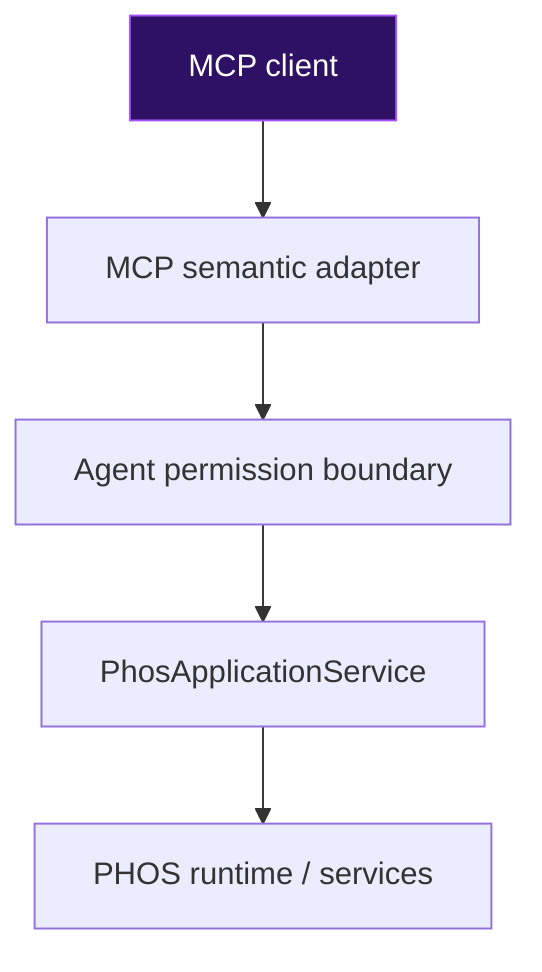

Stage 1 uses the official Python `mcp` SDK (the bounded 2.x line) over
Streamable HTTP. PHOS owns the listener lifecycle: normal runtime startup
creates one listener over the existing application services, and normal runtime
shutdown closes it. It exposes sixteen request/response tools: `phos_get_status`,
`phos_get_physical_context`, `phos_get_presence`, `phos_get_attention`,
`phos_get_observed_expression`, `phos_get_camera_snapshot`,
`phos_capture_camera_snapshot`, `phos_get_visible_objects`, `phos_set_expression`, `phos_speak`,
`phos_sleep`, `phos_wake`, `phos_signal_user`, `phos_query_measurements`,
`phos_list_physical_transitions`, and `phos_set_state`. Every one delegates through
`AgentApplicationService`; MCP owns no permissions, runtime state, provider,
or hardware logic.

MCP clients connect to the already-running PHOS instance. Client sessions do
not create runtimes, application services, or permission boundaries. The
default listener is loopback-only; a non-loopback bind requires explicit
configuration and is warned because credential-backed transport authentication
and network authorization are not implemented.

This is for trusted local/integrated execution. Stage 3.1 resolves a
credential-free local identity; application permissions are not transport
authentication. Do not expose the endpoint on the public Internet. Raw hardware, controller transport, renderer, camera,
audio device, configuration, and administrative/recovery controls are absent.
Stage 2 begins with a transport-neutral semantic event model. The application
service projects meaningful interpreted transitions (robot state, environmental
and air-quality conditions, motion, presence, attention, and observed
expression) into events with stable `type`, `timestamp`, `source`, and
`payload` fields. It does not emit raw telemetry, provider/device details, or
confidence jitter. Consumers may request a validated allow-list of stable event
types; each subscription defensively suppresses only adjacent identical
semantic events during a short internal window, so a real transition from A to B and back to A
remain visible. The model is an internal observer boundary—not the Core event
bus and not an MCP feature. It projects canonical agent-status availability as
one compact `capability_changed` event per changed capability, and canonical
degraded state as `system_health_changed`. The first ready-status snapshot
establishes a baseline and emits neither startup availability nor health events;
later comparisons use the same availability/degraded projection as
`phos_get_status`, with health reasons sorted before comparison. Each observer owns an explicit
`SemanticSubscription` handle with an opaque process-local identifier, active
state, idempotent `close()`, and optional context-manager cleanup. The publisher
holds the handler strongly only while the handle is active; explicit close is
the required ownership boundary. A dispatch snapshot already in progress may
complete when a handle is closed, but no later delivery starts after `close()`
returns. The MCP adapter may consume this model through its bounded
`McpSemanticEventBridge`: standard MCP `subscriptions/listen` clients receive
URI-only `notifications/resources/updated` cues and re-read the relevant
Resource. This remains separate from the Core event bus; REST/WebSocket
delivery and an optional future MCP Events webhook adapter are not Core
responsibilities. Camera resources remain excluded from semantic push cues.

`phos_get_status` is intentionally narrower than `/api/v1/status`. Its agent
status document contains only `running`, `state`, semantic subsystem
`availability`, `degraded`, and `degraded_reasons`. It contains no sensor or
perception values (those belong to physical context), provider/device/model
details, controller session data, LED animation resolution, display state, or
administrative diagnostics. The projection is owned by
`AgentApplicationService`, not the MCP adapter, so future trusted agent
adapters share the same contract.

### 1. Separation of concerns
Core coordinates lifecycle, state, events and behavior. Subsystems implement capabilities.

### 2. Hardware abstraction
Business logic depends on interfaces, not GPIO/device-specific code. Ordinary unit tests must not require physical hardware.

### 3. Events where they reduce coupling
Use events for meaningful asynchronous state changes such as speech recognition, robot-state changes or stable Vision observations. Do not create an event merely to avoid a normal function call.

### 4. Explicit robot state
The existing state model includes `IDLE`, `LISTENING`, `THINKING`, `SPEAKING`, `SLEEPING` and `ERROR`. Keep transitions explicit and testable.

### 5. Incremental verification
PHOS is developed through runnable vertical milestones. Existing code may be ahead of the current verified milestone, but new work should prove one capability before expanding the next major subsystem.

## Visual / behavior path

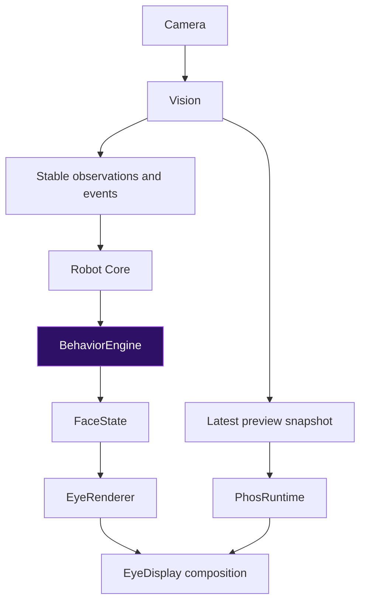

Vision observes. Behavior interprets observations in the context of PHOS's own `RobotState`. `EyeRenderer` consumes only `FaceState` and handles rendering/animation details. The display adapter may compose an optional local diagnostic preview from a UI-neutral snapshot supplied by `PhosRuntime`; it never accesses camera or Vision providers.

The face-rendering frequency is independent from Vision timing so the display can remain smooth while detection/inference runs at a lower rate.

`BehaviorEngine` currently lives under `src/robot/core/`, because behavior is part of Core orchestration in the checked-out implementation.

### Visual reaction semantics

Vision classifies an uncertain **visible facial expression**, not a person's
internal emotional state. `BehaviorEngine` gives PHOS its own response and
produces the UI-neutral `FaceState`; Vision never selects renderer geometry or
colors directly.

| Stable visible-expression observation | PHOS behavior | `FaceExpression` | `VisualAccent` |
| --- | --- | --- | --- |
| neutral | calm acknowledgement | neutral | neutral |
| happiness / happy | warm, friendly response | happy | warm |
| surprise / surprised | alert, open response | surprised | alert |
| unknown (including rejected/negative FER classes) | preserve and decay to baseline | unchanged, then neutral | unchanged, then neutral |

Vision publishes semantic evidence, not individual negative FER labels.
UNKNOWN is an explicit absence of accepted evidence. It is distinct from a
positively confirmed neutral observation; current uncalibrated models abstain
on neutral. See `docs/vision.md` for thresholds and temporal rules.

`FaceState` carries the expression, semantic `VisualAccent`, and
`reaction_strength` independently. Its optional signed `eye_asymmetry` is
provider-neutral visual intent: positive opens the left eye by that amount and
closes the right by the same amount; negative mirrors it; zero requests equal
eyes. When absent, the renderer uses the expression profile's ordinary shape.
The renderer maps accents to its own color
palette: neutral light cyan/white, warm turquoise, curious cyan/blue, alert
amber, sleepy muted violet, and error red. Strength blends the neutral and
accent colors, as well as the existing eye-shape profile. Eye, pupil, and
background color transitions interpolate at render cadence rather than jumping
at Vision inference cadence.

Environmental interpretation also supplies independent, confirmed temperature
and air-quality overlay intents on `FaceState`. They are composable renderer
inputs only: the single priority-selected `EnvironmentalState` remains the
contract for existing eye and LED behavior, while the display can show, for
example, both a warm-temperature marker and an air-quality haze without
reinterpreting sensor readings or thresholds.

Robot state remains higher priority than Vision: listening/thinking use a
curious accent, speaking uses warm, sleeping uses sleepy, and error uses red.
Happy reactions refresh only from confirmed observations and decay smoothly
back to neutral when evidence stops. Surprise is temporary, cannot refresh from
a sustained pose, and needs confirmed alternative evidence plus a cooldown
to rearm. UNKNOWN allows normal decay. Face tracking and blink timing
remain independent from expression inference.

`VisualAccent` is deliberately provider-neutral. The optional WS2812B LED-ring
controller consumes the same `FaceState` semantic accent and strength through a
separate low-rate worker. It does not receive Vision, IMU or sensor objects and
does not alter `BehaviorEngine` decisions or eye rendering.

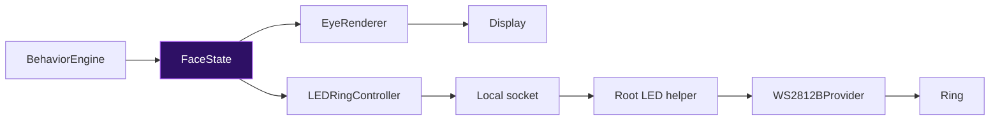

### External-controller semantic LED arbitration

External controller LEDs use a separate semantic path: `SemanticLedService`
owns source-scoped requests, priority arbitration, expiry, and command
deduplication; the controller executes only the resolved realtime animation.
`RobotState` contributes one persistent intent, environmental context contributes
a lower-priority ambient intent, and `signal_user` contributes the bounded
semantic signals `success`, `warning`, `error`, or `attention`. All user
signals, including `signal_user("error")`, are transient. In contrast,
`RobotState.ERROR` contributes the persistent `robot_state/error` intent until
the robot state changes. Error wins over warning, transient user signals,
robot-state intents, and ambient context.
Neither `BehaviorEngine`, Web/API adapters, nor firmware choose animation
parameters. On a controller capability report the arbiter reapplies its current
winner; when LED capability is absent it retains logical intent and emits no
hardware command.

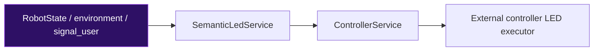

## Runtime

`PhosRuntime` is the current application coordinator. It supervises Core/UI and optional Vision tasks and handles lifecycle/failure boundaries.

Keep orchestration thin. Do not move expression classification, rendering geometry or model-provider logic into the runtime. Camera/inference/render/audio work must not collapse into a single blocking loop.

The existence of the integrated runtime does not override milestone discipline: each capability still needs independent runnable verification.

## AI provider architecture

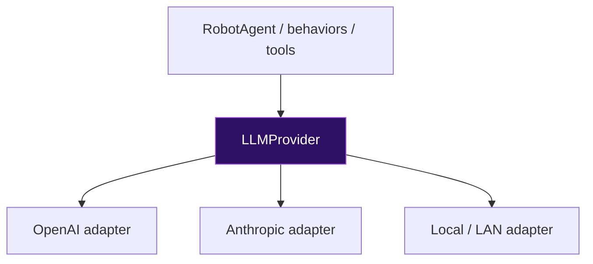

`LLMProvider` is the only model interface visible to the rest of the robot. Provider adapters translate neutral messages/tools/tool calls to and from vendor-specific formats.

The primary conversational model is not assumed to run on Raspberry Pi 3. Cloud API or LAN-hosted models are valid; a deliberately small local fallback may be explored later.

## Voice architecture

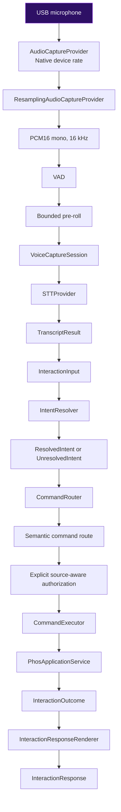

Capture rate and processing rate are deliberately separate. Raspberry Pi 3
validation uses a USB microphone at 44.1 kHz, followed by the one canonical
resampling boundary to the 16 kHz stream consumed by VAD and STT; microphones
need not support 16 kHz natively.

The current explicit capture session stops at transcription:

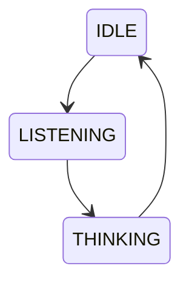

VAD confirmation takes time, so its bounded 300 ms pre-roll
preserves audio preceding speech-start confirmation. The validated baseline is
threshold 50, speech start 120 ms, silence end 700 ms, minimum utterance 300
ms, maximum utterance 12000 ms, and pre-roll 300 ms. These are validated
baseline values, not universal calibration values.

`STTProvider` keeps transcription provider-neutral; `VoskSTTProvider` is the
first local/offline implementation, not PHOS's architectural identity. The
small English Vosk model validates the local architecture but can have limited
accuracy for longer phrases and non-native English accents.

Voice input publishes status/events and uses centralized runtime state
transitions. It does not control GPIO, renderers, LEDs, or `BehaviorEngine`.
`robot.interaction` provides plain `TranscriptResult`, `InteractionInput`, and
canonical resolved/unresolved intent contracts. Its async `IntentResolver`
boundary interprets language only; it has no runtime/hardware access and does
not route or execute commands. The selectable deterministic resolver has a
small exact English/Italian catalog for state, expression, temperature,
pressure, and air-quality commands; see [Voice Commands](voice-commands.md)
for the user-facing accepted phrases. When interaction is enabled,
the main runtime observes completed voice transcripts and publishes resolution
events/status. `CommandRouter` separately validates a resolved canonical intent
and maps it to a semantic command. Voice execution is opt-in through
`interaction.execution_enabled` (false by default): the coordinator creates a
voice-scoped allowlist, then `CommandExecutor` invokes sleep, wake, expression,
and authorized sensor commands through `PhosApplicationService`. Sensor queries
reuse that service's read models and produce an
`InteractionOutcome` with canonical numeric fields; unavailable snapshots are
normal outcomes. The pure local `InteractionResponseRenderer` produces
deterministic English or Italian user-facing text from query outcomes. With
`interaction.response_tts_enabled` (false by default), query responses pass through
the application speech boundary and the existing synthesis/playback path:

This includes `SPEAKING`; actions and unresolved input remain silent. The current
provider-neutral TTS contract accepts text only, so response language is retained as
interaction metadata rather than passed as a provider-specific argument. Local Piper,
Cartesia and ElevenLabs adapters are implemented.
Phrase resolution, command routing/execution, wake words, continuous listening,
LLM conversation, and Home Assistant remain future work.

Physical validation on Raspberry Pi 3 with a USB microphone confirmed native
capture, resampling from 44.1 kHz to 16 kHz, VAD, preserved speech onset through
pre-roll, local Vosk transcription, and return to `IDLE`.

## Vision architecture

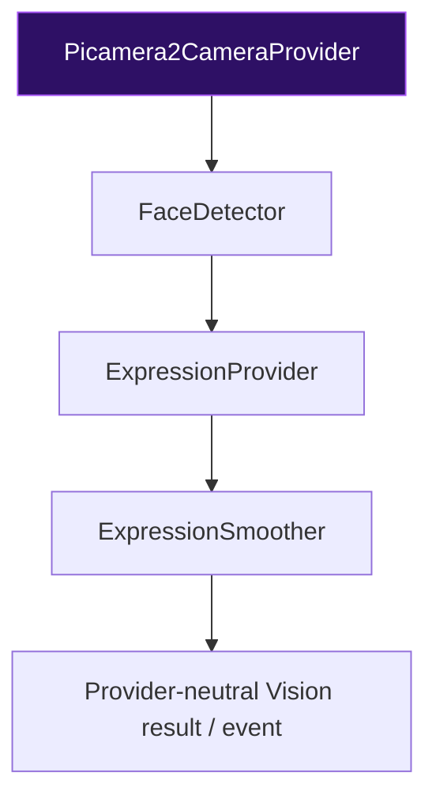

Use lightweight processing appropriate for Raspberry Pi 3. Expression classification describes uncertain visible facial-expression patterns, not a person's true mental/emotional state. No identity recognition or frame persistence by default.

## Home Assistant relationship

Home Assistant is an integration/tool surface, not PHOS's brain. Commands may use REST, state/events may use WebSocket, and MQTT may later expose PHOS entities. AI access must be mediated by explicit tools/services and allowlists; sensitive actions require explicit policy.

### Local/cloud expression boundary

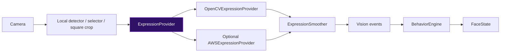

AWS SDK objects remain in its adapter. Cloud requests use a single background
asyncio task plus `to_thread`, independent of capture/tracking/render cadence.
Provider lifecycle invalidation discards evidence across tracking discontinuity.
Cached `ExpressionObservation.sampled_at` preserves provenance so reads cannot
manufacture temporal confirmation. Local observations retain their existing
cadence and semantics. See [Vision](vision.md#selectable-local-aws-expressions).

`config/phos.yaml` is the sole supported source of normal runtime settings. The
provider-neutral `robot.config` module validates its required sections and maps
them to `RuntimeConfig` and `CloudExpressionConfig`, with no hardware, SDK or
argparse dependencies. The runtime passes only relevant typed values to each
subsystem. Startup validates before constructing any camera/display components;
paths are relative to the configuration file. Existing constructor fallback
values are not consulted by application composition.

The same file/dict validation, serialization and atomic persistence must be used
by the optional web configuration interface. Credentials are never fields in
application settings. `SecretsService` keeps runtime-only provider credentials in
an authenticated encrypted local store; its web facade reports slot status and
permits replacement/removal but deliberately cannot read values. New ordinary settings
must extend this central model/file, not standalone CLI arguments. Existing CLI
settings are deprecated explicit overrides during migration. Logging level, display
iris appearance and camera-preview settings can be reloaded through the lifecycle
service; supported Voice & Speech STT/TTS/audio changes use runtime-aware live
activation and persistence, while other subsystem changes require restart. See
[configuration reference](development.md#configuration).

## Administration adapter

`robot.web` wraps the canonical configuration service with structured settings
forms and an advanced YAML editor, both backed by the same ConfigRepository.
The separate Credentials page uses the write-only `WebSecretsService` facade,
never `SecretsService.get_secret`, so secrets cannot enter page rendering or an
administrative response. Provider integration remains separate from this storage
foundation.
Waitress runs in a separate process owned by the main startup lifecycle,
independent of rendering/Vision. It receives startup settings for a
saved-versus-startup comparison; runtime-backed pages request semantic status
through the bounded application/lifecycle channel rather than reading subsystem
internals directly.
Its password-storage service is separate from runtime JSON; Flask sessions and
Flask-WTF protect administration actions. Core, providers and the renderer have
no web-framework dependency. See the [web manual](web-administration.md).

Administration domains select canonical field paths for presentation only. Each
page merges its submitted fields into the complete document and calls the same
validation/persistence boundary. System / Status is read-only; password changes
use the separate credential service. See the manual for the domain-to-field map.

## Shared application services for control surfaces

Web, future remote API, MCP and Voice are adapters around PHOS application
services. They reuse the same validation, authorization, configuration and
behavior-command services; they must not reach into GPIO, hardware adapters,
provider objects, renderer state or other subsystem internals. Add an application
service when an approved capability needs one, rather than duplicating behavior
in each surface. The configuration, Remote API, supported Voice & Speech, and
MCP semantic application services are implemented examples.

## Application lifecycle boundary

`robot.lifecycle.LifecycleService` owns the active-configuration snapshot and
allowed status/reload/restart operations. Reload validates the full canonical
file before applying logging level, iris appearance and camera preview through their
application-service boundaries. Supported Voice & Speech changes use a separate
candidate-activation/persistence transaction; other changes remain pending. The parent process serves a bounded local process channel to the web
worker; adapters cannot submit shell commands, paths or arbitrary configuration
payloads. Future API/MCP surfaces must use the same policy service.

The supplied user systemd service owns process replacement. A confirmed restart
requests graceful runtime shutdown and exit code 75; systemd restarts the same
entry point. The web adapter neither runs OS commands nor spawns replacements.
Runtime subsystem and web-worker failures propagate as nonzero process exits for
systemd recovery. Preview reload is acknowledged after camera start/stop acceptance;
failed starts release partially acquired camera resources, and shutdown drains
preview tasks and supervisor waiters. Manual launches reject browser restart. OS reboot and general remote control
remain out of scope. See installation for display-session environment and service
permissions. Status distinguishes configured values from runtime active/availability
state where that snapshot is available; it does not invent a health-monitoring layer.

## Eye appearance

The Display & Appearance configuration supplies the validated canonical iris color
to EyeRenderer at startup. EyeRenderer still consumes only FaceState and renderer
style configuration; expression/provider labels never reach the renderer.
Semantic visual accents continue to pass through BehaviorEngine and FaceState.
Tk draws layered eye-body, iris, pupil and highlight primitives without a
raster-processing pipeline. Iris appearance can be applied live through the
configuration lifecycle and render-loop queue; display geometry/backend changes
still require PHOS restart.

## Environmental sensor service

The separately approved BME280/BMP280 addition follows:

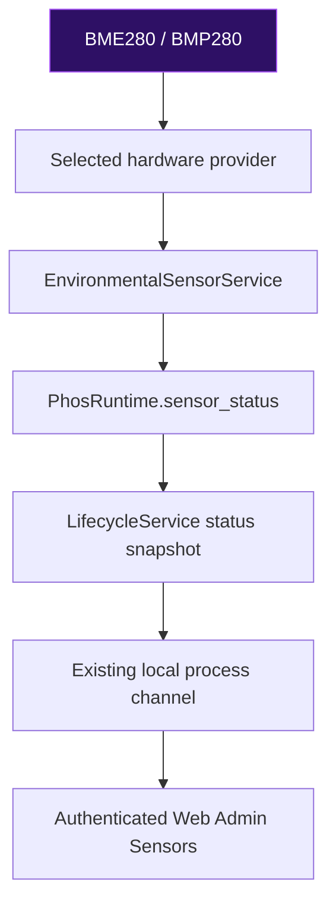

`robot.sensors` owns the provider-neutral contract, immutable measurements and
latest-state service. The `robot.hardware` adapters alone know the SMBus/driver APIs.
`hardware.environmental.environmental_provider_type` centralizes selection and
capabilities. Both return `EnvironmentalReading` with temperature/pressure and
nullable `humidity_percent`; BMP280 must return null, BME280 must supply humidity.
The service validates that invariant using declared available measurements.
The runtime constructs and starts/stops the service and passes only its typed,
fresh snapshots to `EnvironmentalInterpreter`. The interpreter publishes
confirmed semantic state and independent overlay intents to BehaviorEngine;
raw readings never reach EyeRenderer, LEDRingController or Vision. Future
compatible environmental providers reuse this boundary; other kinds of sensors need their own typed
measurements rather than forcing them into temperature/humidity/pressure fields.

One daemon worker serializes all provider calls; disabled means no worker,
provider construction, vendor imports or I2C open. It retries initialization after
failures, retains no history and exposes only finite valid current measurements.
Snapshot metadata includes active sensor type, available measurements, availability/status, UTC last success, monotonic age
and sanitized error type. Failed or stale snapshots contain no current values.
A blocked native call cannot stop the render loop or grow a work queue; stop
signals the worker and awaits at most one second. The owner closes the bus when
I/O returns; process exit releases it if stuck. No concurrent bus close is used.

All settings are restart-only under existing lifecycle classification. Save and
Reload do not restart any subsystem. Only an explicitly requested PHOS restart
reinitializes hardware. The Sensors page reads in-memory state via shared services,
never imports a driver or infers availability from saved enabled/address values.
The existing authenticated process channel carries the snapshot; no new API or
IPC operation is exposed. See ADR-022, [hardware](hardware.md#bme280) and
[configuration migration](development.md#environmental-configuration-migration).

### Controller-backed ENS160 and AHT21

The controller acquires measurements and publishes phos-hw v1
records; Pi services own freshness, validity, controller-generation isolation and
environmental interpretation. ENS160 provides estimated eCO2, TVOC and AQI-UBA;
AHT21 temperature and humidity are independently fresh. Retiring a session
immediately makes controller readings unusable until fresh telemetry arrives.

### MPU-6050 IMU extension

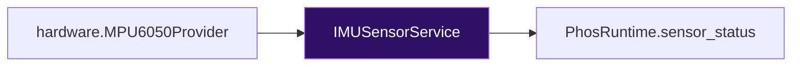

This path uses the same worker, freshness, retry and authenticated status boundary as the other
sensors. `IMUReading` holds acceleration X/Y/Z in m/s² and angular velocity X/Y/Z
in °/s. The hardware adapter alone knows MPU-6050 registers and smbus2; Web Admin
only reads snapshots and edits canonical `sensors.imu` settings. No BehaviorEngine,
EyeRenderer or Vision component receives IMU readings. The adapter applies fixed
±2 g / ±250 °/s scale factors only; offset calibration, fusion and orientation are
outside this capability.

### Motion interpretation extension

Motion interpretation is a pure, provider-neutral layer between IMU state and its semantic consumers. It never accesses
the MPU-6050, GPIO, Web handlers, Vision, EyeRenderer or BehaviorEngine. The IMU
worker supplies timestamped samples and exposes only the current interpreted
state and last event through the existing status boundary. `STILL`, `MOVING`,
four tilt directions, `SHAKE` and `IMPACT` are semantic observations consumed by
BehaviorEngine through the event bus. Motion settings reload into the interpreter
without reopening the I2C provider.

### IMU visual behavior extension

The IMU service publishes stable semantic state changes to Core's local event
bus. `BehaviorEngine` consumes them and overlays visual intent onto `FaceState`;
the renderer still receives no IMU object or event. In `IDLE`, MOVING recenters
the pupils, opens the eyes to 1.16 and gives it 0.63 reaction strength. Each
tilt moves pupils in the corresponding visual direction at 86% of the normalized
safe range. Horizontal tilts also use a mirrored 0.18 signed eye asymmetry:
left tilt opens the left eye and closes the right, right tilt reverses it.
Forward/back keep equal eyes, opening to 1.23/closing to 0.82; horizontal tilts
use 1.12. All have 0.56 strength and the curious accent. SHAKE is a 1.18-open, 0.88-strength surprised
alert; IMPACT is the stronger 1.25-open, 1.0-strength alert. Both hold for 55%
of their configured duration then decay smoothly.
`ERROR`, `SLEEPING`, `LISTENING`, `THINKING` and `SPEAKING` override IMU intent;
motion then resumes only when Core returns to IDLE. Motion overlays take priority
over lower-priority Vision expression reactions in IDLE, without changing the
user-selected iris theme.

### Local Admin Access

`NetworkInfoService` is parent-process runtime state, not configuration: it
selects the first non-loopback, non-link-local IPv4 address and refreshes its
bounded cached result every 30 seconds. Web Admin obtains that read model only
through `RemoteApplicationService` and lifecycle. The physical Admin overlay is
a separate top display layer. It receives only the effective LAN Admin URL and
a cached `qrcode` matrix; Tk renders individual square canvas modules, so Pillow
and image resampling are unnecessary. A top-right double-tap
20% of the display opens it, and a tap closes it. This never changes
`FaceState`, `RobotState`, or `BehaviorEngine` state.
