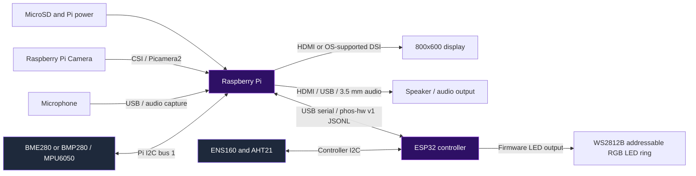

# Hardware Bill of Materials (BOM)

Start with a Raspberry Pi and display for a desktop PHOS build, then add a
camera, voice hardware, sensors, and an external controller as needed. The
tables separate the core setup from optional capabilities and list the
interfaces used by the current providers.

## Choose a build tier

| Tier | Parts | Enables |
| --- | --- | --- |
| **1 — Core / minimal build** | Raspberry Pi, microSD, power supply, display and cables; camera for vision | Animated eyes and UI, plus camera observations when configured |
| **2 — Voice & audio add-on** | Tier 1 plus microphone and audio output | Bounded STT/voice-command sessions and TTS playback |
| **3 — Sensors & external controller** | Tier 1 plus your choice of I2C sensors, ESP32 and LEDs; add Tier 2 for speech | Environmental and motion context, air-quality telemetry, and semantic LED feedback |

-   :material-monitor: **Start with the face**

    ---

    Install Raspberry Pi OS with a graphical desktop and connect the display.
    The camera is required for vision, but can be omitted for an eyes-only build.

-   :material-account-voice: **Add speech**

    ---

    Connect a microphone and speaker, then select the STT and TTS providers in
    [Voice & Speech](voice.md).

-   :material-chip: **Expand physical context**

    ---

    Add local I2C modules or an ESP32 running matching `phos-hw` v1 firmware.
    Enable one configured capability at a time.

## Tier 1 — Core / minimal build

| Component | Quantity | Interface / selection notes |
| --- | --- | --- |
| Raspberry Pi | 1 | Raspberry Pi 3 is the repository baseline; a 3 Model B+ is a build choice in that family. A Pi 4 or another Debian-based board is an alternative build target that needs its own OS, camera and display setup; installer architecture checks accept `armv7l` and `aarch64`, not arbitrary boards. |
| microSD card | 1 | Suggested starting size: **16 GB or larger, Class 10**. This is a planning recommendation, not a runtime-enforced minimum; allow space for OS packages and local speech/vision models. |
| Power supply | 1 | Use a regulated supply and cable appropriate to the selected Pi and the attached USB load. Account separately for display and LED power. |
| Display | 1 | Reference size/resolution: **5-inch, 800×600**. Choose HDMI or DSI according to the Pi and panel, with matching display power and cables. PHOS renders through the local graphical desktop; it has no panel-specific driver. |
| Raspberry Pi Camera Module and ribbon cable | 1 for vision | CSI camera supported by the installed Picamera2/libcamera stack. Select the ribbon/connector for your board; the reference camera model is unspecified. |
| Network connection | 1 during setup | Ethernet or Wi-Fi for cloning, package installation, and optional LAN administration or agent access. |

Follow [Build PHOS](build-phos.md) and the [installation guide](installation.md).
Touch gestures additionally require touchscreen input recognized by the OS.

## Tier 2 — Voice & audio add-on

| Component | Quantity | Interface / purpose |
| --- | --- | --- |
| USB microphone or compatible audio input | 1 | Input device recognized by the configured capture stack; capture is resampled to canonical 16 kHz PCM16 mono for STT. |
| Speaker with an audio output path | 1 | HDMI/display audio, supported USB audio, or the selected Pi's 3.5 mm output. A passive speaker needs an appropriate amplifier. Configure ALSA `aplay` or PipeWire `pw-play` output. |

STT supports local Vosk and optional Cartesia. TTS supports local Piper,
Cartesia, and ElevenLabs, with synthesis and playback configured separately.
Install local model assets or configure the selected cloud provider's
credentials through the external secrets boundary. See [Voice](voice.md) and
[TTS](tts.md).

## Tier 3 — Sensors & external microcontroller add-ons

Select only the modules needed for your build. Pi I2C providers use bus 1;
ENS160/AHT21 use the controller's I2C bus.

| Component | Quantity | Interface / addresses | Measurements or function |
| --- | --- | --- | --- |
| ESP32 board and USB data cable | 1 for controller-backed hardware | USB/serial, `phos-hw` v1 UTF-8 JSONL; default host settings `/dev/ttyACM0`, 115200 baud | Sensor telemetry, capability discovery, heartbeat/reconnect, and semantic LED commands. Matching firmware is external to this repository. |
| Bosch BME280 **or** BMP280 breakout | 1 optional | Pi I2C bus 1, `0x76` or `0x77`; 3.3 V-compatible logic | Both: temperature and pressure. BME280 also measures humidity; BMP280 has no humidity output. Select the matching type in configuration. |
| ENS160 + AHT21 combo module | 1 optional | ESP32 I2C: ENS160 `0x53` or `0x52`, AHT21 `0x38` | ENS160: estimated eCO2, TVOC, AQI-UBA 1–5, validity and compensation status. AHT21: temperature and humidity. No direct Pi I2C provider. |
| MPU6050 / GY-521 breakout | 1 optional | Pi I2C bus 1, `0x68` or `0x69` | Six-axis acceleration and angular velocity, interpreted motion and tilt. Configure mounting axes. |
| WS2812B addressable RGB LED ring | 1 optional | ESP32 firmware-selected output; `phos-hw` v1 semantic LED commands over Pi-to-ESP32 USB/serial | Firmware drives the ring. Set LED count, pin, channel ordering, and power to match the fitted hardware; an active controller connection and advertised LED capability are required. |
| Jumper wires, connectors and mounting hardware | As needed | Match the breakout pinout and enclosure | Secure connections and consistent sensor orientation. |

ENS160 eCO2 is an estimated CO2 equivalent, not a direct NDIR CO2 measurement.
See [hardware wiring](hardware.md), [motion setup](motion-awareness.md), and the
[controller protocol](hardware-controller.md).

## Wiring map

## Wiring & configuration checklist

1. Power off before wiring. Check each breakout's supply requirements, labels,
   logic levels, and schematic; Pi GPIO/I2C uses **3.3 V logic**.
2. Enable Pi I2C for local sensors and confirm their configured addresses. Keep
   ENS160/AHT21 on the ESP32 bus and provide a common ground for connected hardware.
3. Check display, camera and audio devices through the OS, then run PHOS from
   the local graphical desktop.
4. For ESP32, use a USB **data** cable, the correct serial device and permissions,
   matching baud rate, and firmware implementing the documented v1 messages.
5. Set the ESP32 firmware's actual LED pin/count and power requirements. Use a
   suitable external LED supply and level shifting where required; do not power
   a ring from a GPIO pin.
6. Enable the selected provider, restart or reload as documented, then inspect
   availability, freshness and readings in Web Admin before adding another module.

!!! tip "Enable only the hardware you have connected"

    Edit the canonical [`config/phos.yaml`](https://github.com/phosairobot/phos/blob/dev/config/phos.yaml)
    after wiring. Optional sensors, the controller, LED ring, camera processing,
    voice and TTS start disabled. Configure `sensors.environmental`,
    `sensors.ens160`, `sensors.imu`, and `hardware_controller` for
    the selected path. The ESP32 ring requires `hardware_controller.enabled: true`
    and controller-advertised LED capability; keep legacy `led_ring.enabled: false`.
    Controller-backed sensors use `provider: controller`
    and an enabled controller. Keep credentials outside runtime configuration.
