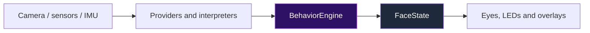

---
hide:
  - navigation
  - toc
classes:
  - phos-home
---

# How PHOS works

PHOS keeps physical devices, observations, behavior decisions and rendering
separate. This makes reactions understandable, testable without a Raspberry Pi
and practical on Pi 3 hardware.

Camera and sensor services publish typed observations. Interpreters add
confirmation, freshness and semantic meaning. `BehaviorEngine` then decides
the UI-neutral `FaceState`; renderers consume that intent but never inspect raw
camera frames or sensor readings.

Web Admin is also an adapter: it uses shared configuration and lifecycle
services rather than reaching into hardware or renderer internals. Future API,
MCP and voice surfaces must follow the same boundary.

For subsystem-level contracts, diagrams and accepted design decisions, read the
[canonical architecture reference](architecture.md).
