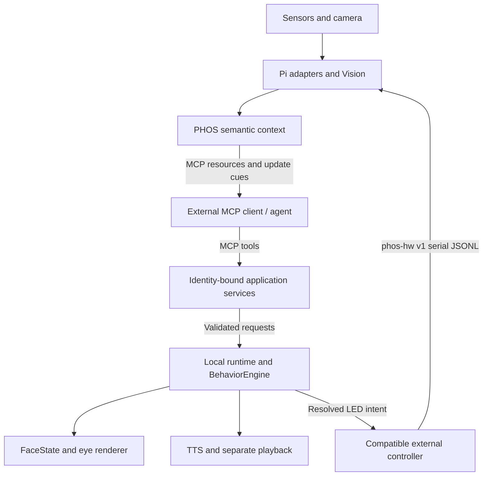

---
hide:
  - navigation
  - toc
classes:
  - phos-home
---

# How PHOS works

PHOS connects physical observations to external agents and turns authorized
agent requests into physical expression. The agent decides what the context
means for its task; PHOS owns the local runtime and execution.

## Perceive

Pi adapters and compatible external controllers acquire measurements and
observations. PHOS interpreters add confirmation, freshness, and semantic
meaning: a temperature measurement and a confirmed environmental condition are
different information. Presence describes anonymous human presence, not identity;
visible-expression classification does not establish a person's emotions.

The shared physical-context model includes environment, air quality, motion,
presence, attention, observed expression, and robot state. Touch gestures are
local input with separate REST/Admin telemetry, not a dedicated MCP resource.
Raw orientation vectors are available through motion telemetry; MCP physical
context exposes interpreted motion rather than those vectors.

## React

An MCP client discovers tools and resources, then reads current context when
needed. Clients supporting `subscriptions/listen` can also receive URI-only
notifications for selected semantic changes and read the resource again. This
avoids continuous polling for those changes, but is not raw telemetry delivery.
The client or host decides whether to invoke agent reasoning.

## Express

The agent can call tools for supported expressions, temporary thinking visuals,
speech, sleep/wake, and user-attention LED signals. Application services check
permissions and availability before asking the runtime to act. Local state and
behavior arbitration still apply. Optional outputs require their configured
hardware and providers.

Local gaze, blink, and visual behavior are resolved by `BehaviorEngine` into
UI-neutral `FaceState`; the renderer does not interpret Vision observations.
MCP does not expose direct gaze, GPIO, or serial commands. Web Admin, REST,
and local voice commands also use shared application services rather than
owning separate hardware control logic.

## Keep the boundaries clear

| Boundary | Responsibility |
| --- | --- |
| Physical device / controller | Acquire observations and execute supported physical output. |
| `phos-hw` v1 | Carry controller capabilities, validated observations, and resolved LED commands over serial. |
| PHOS runtime | Own devices, interpret context, apply state and output arbitration. |
| MCP adapter | Expose semantic resources, notifications, and tools through identity and permission checks. |
| External host / agent | Choose context, reason about it, coordinate workflows, and request actions. |

The runtime is required for both agent-connected and
[standalone operation](discover.md#standalone-operation). For deeper contracts,
read [MCP integration](mcp-overview.md), the [controller protocol](hardware-controller.md),
and the [runtime architecture](architecture.md).
