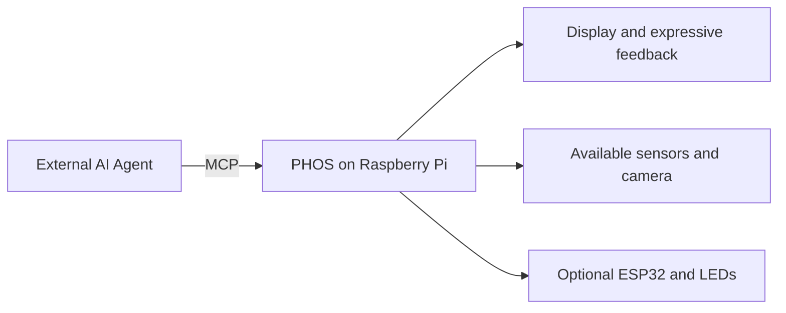

---
hide:
  - toc
classes:
  - phos-home
---

{ .phos-landing-logo width="128" height="128" }

# Give Your AI Agent a Physical Presence.

PHOS is an open-source Raspberry Pi platform for physical perception and expressive feedback. It lets compatible external AI Agents read bounded context and request permitted real-world interactions through MCP.

[Build PHOS](build-phos.md){ .md-button .md-button--primary }
[Connect an AI Agent](developer-quickstart.md){ .md-button }
[Explore on GitHub](https://github.com/phosairobot/phos){ .md-button }

PHOS is not an autonomous LLM robot. **An external Agent reasons and decides;
PHOS owns the physical runtime, permissions, sensors, display, and execution.**
It can also run as a standalone expressive Raspberry Pi project without an
external Agent.

<section class="phos-mode-card" markdown>

## I want to build PHOS

Start with the verified Raspberry Pi 3/display baseline, install the runtime,
and add camera, audio, sensors, LEDs, or an ESP32 controller only when you are
ready. No AI service is required to see the eyes and run supported local paths.

[Start the guided build](build-phos.md){ .md-button .md-button--primary }

</section>

<section class="phos-mode-card" markdown>

## I want to connect an AI Agent

Use PHOS's authenticated Streamable HTTP MCP endpoint to inspect semantic
physical context and request permitted expression, speech, state, or signal
actions. PHOS never gives a client raw GPIO or controller access.

[Start the developer quickstart](developer-quickstart.md){ .md-button .md-button--primary }

</section>

## What PHOS can do today

:material-eye-outline:{ .phos-capability-icon }

### Express information

Render animated eyes, supported expressions, gaze, blink behavior, and local
overlays. Optional LEDs extend the same semantic visual intent.

:material-chart-line:{ .phos-capability-icon }

### Observe physical context

Expose available environmental, air-quality, motion, presence, attention, and
camera-derived observations as bounded semantic data—not identity claims.

:material-connection:{ .phos-capability-icon }

### Connect an Agent

Serve permission-checked MCP tools, Resources, and update cues over Streamable
HTTP so an external Agent can decide how to respond.

:material-account-voice:{ .phos-capability-icon }

### Speak and signal

With configured audio hardware and providers, speak bounded text; with optional
hardware, present semantic LED feedback. Availability remains explicit.

## How it works

The diagram describes a boundary, not an autonomous control loop: agents make
high-level decisions; PHOS validates requests and manages its hardware.

## Real media and project maturity

The repository currently includes the official PHOS logo, not a verified
photograph or video asset that can be presented as the reference build. For
project updates and externally published demonstrations, visit the
[PHOS YouTube channel](https://www.youtube.com/@phosairobot) and the
[GitHub repository](https://github.com/phosairobot/phos). Hardware acceptance
is component-specific; see the [roadmap](roadmap.md) before treating an optional
module as verified for your build.

## Where to go next

| Your goal | Recommended path |
| --- | --- |
| Make the eyes appear on a Pi | [Build PHOS](build-phos.md) |
| Check required and optional components | [Hardware requirements](hardware-overview.md) |
| Connect a compatible client | [Developer quickstart](developer-quickstart.md) |
| Inspect exact MCP contracts | [MCP reference](mcp.md) |
| Change settings safely | [Web Administration](web-administration.md) |
| Report an issue or understand project status | [Contributing & project status](contributing.md) |
