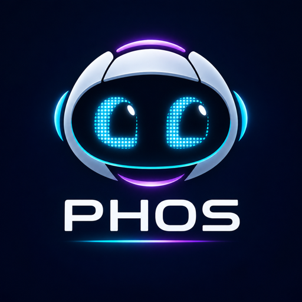
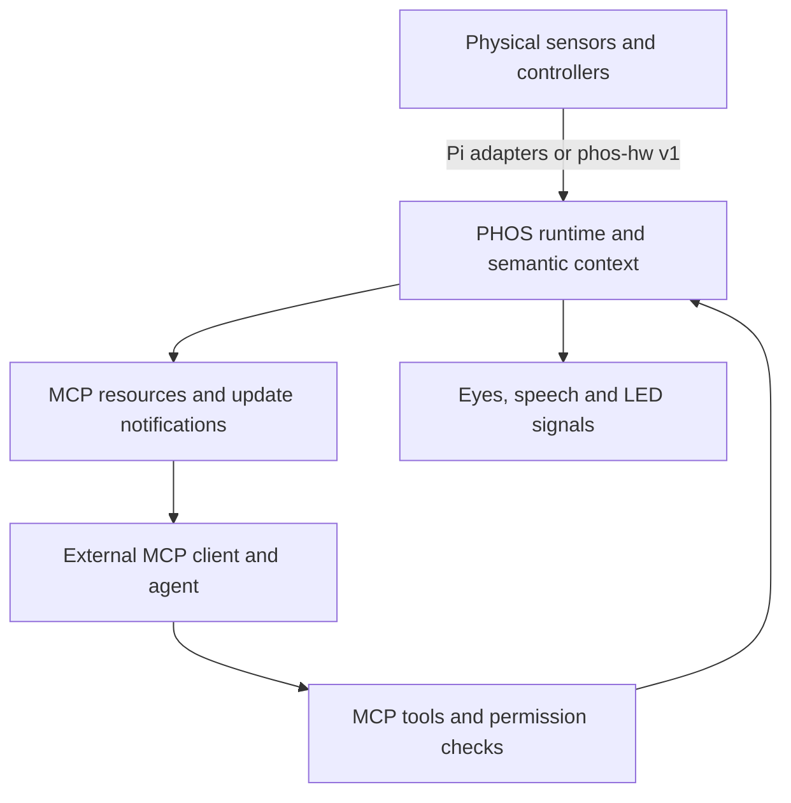

---
hide:
  - toc
classes:
  - phos-home
---

{ .phos-landing-logo width="128" height="128" }

# Bringing AI agents into the physical world.

**Eyes, voice and senses for AI agents.**

Give your agent physical context and a way to communicate beyond chat. PHOS connects supported sensors to AI agents and turns authorized requests into expressive eyes, speech, and visual signals.

[Connect your agent](developer-quickstart.md){ .md-button .md-button--primary }
[How PHOS works](how-phos-works.md){ .md-button }

PHOS is **an open-source, bidirectional physical I/O layer for AI agents,
powered by the Model Context Protocol.** Your external agent provides reasoning;
the local Raspberry Pi runtime provides physical perception and execution.

**Bring your own agent. Bring your own hardware.** Use a compatible MCP client
and the supported Pi peripherals or a controller implementing `phos-hw` v1.
Hardware features depend on the devices and providers configured in your build.

## Watch PHOS in Action

Explore two English-language demos from the official PHOS channel: live
physical context through MCP and analysis of recent environmental history.

  <figure class="video-card">
    

      <iframe src="https://www.youtube-nocookie.com/embed/FeNdXLksbAA?rel=0" title="How to integrate Raspberry Pi with ChatGPT using MCP" loading="lazy" referrerpolicy="strict-origin-when-cross-origin" allow="encrypted-media; picture-in-picture; fullscreen" allowfullscreen></iframe>
    

    <figcaption>
      <strong>How to integrate Raspberry Pi with ChatGPT using MCP</strong>
      ChatGPT reads available eCO₂, TVOC, temperature, and humidity through MCP without direct hardware access.
    </figcaption>
  </figure>
  <figure class="video-card">
    

      <iframe src="https://www.youtube-nocookie.com/embed/KMd93sneYoE?rel=0" title="Giving AI Agents Access to Real Sensor History | Raspberry Pi + ESP32 + MCP" loading="lazy" referrerpolicy="strict-origin-when-cross-origin" allow="encrypted-media; picture-in-picture; fullscreen" allowfullscreen></iframe>
    

    <figcaption>
      <strong>Giving AI Agents Access to Real Sensor History | Raspberry Pi + ESP32 + MCP</strong>
      An AI agent queries available measurements from a three-hour window of bounded RAM telemetry from ESP32 and Raspberry Pi to analyze trends.
    </figcaption>
  </figure>

[More Videos on @phosairobot](https://www.youtube.com/@phosairobot){ .md-button }

## Perceive, react, express

-   :material-eye-outline: **Perceive**

    ---

    Read available environmental measurements, motion, human presence, and
    attention as structured physical context, with availability and freshness.
    Your agent uses PHOS interfaces instead of managing sensor drivers.

    [Explore physical awareness](features.md)

-   :material-connection: **React**

    ---

    Compatible clients subscribe to resource changes and retrieve updated
    context without continuously polling for semantic transitions. Your agent
    or host decides whether to respond.

    [Understand resource updates](mcp-overview.md#react-to-changes)

-   :material-account-voice: **Express**

    ---

    Communicate activity through animated eyes, supported expressions, and a
    temporary thinking state. Add configured speech or controller-backed LED
    signals so people can notice agent activity away from a chat window.

    [See the interaction model](how-phos-works.md)

## How PHOS works

MCP connects agents to PHOS. The separate `phos-hw` v1 serial protocol connects
compatible external controllers to the Pi. The official ESP32 firmware is a
reference implementation; an external controller is optional. The local PHOS
runtime is required for physical execution.

## One physical interface, different agents

PHOS works through MCP rather than a particular model or agent framework.
Register independent agent identities, issue separate bearer credentials, and
choose read-only `observer` or action-capable `standard` access. Multiple clients
use the same runtime; physical outputs remain shared and subject to PHOS
arbitration. PHOS provides no agent orchestration or isolated output devices.

Resource reads and tool calls pass through application permissions and runtime
checks. Camera snapshots require separate permission and are requested on
demand. Resource notifications contain a URI, not images or sensor payloads;
they are best-effort cues rather than a guaranteed event stream.

[Explore agent access and security](mcp-overview.md#multiple-agents-and-controlled-access)

## What will you build?

- **A physical presence for an agent:** express activity or speak a concise reply.
- **Coding feedback you can notice:** have your integration request a thinking
  visual during a task and a supported expression or LED signal on completion.
- **Presence-aware interactions:** let external logic read confirmed anonymous
  presence and decide when a response is useful.
- **Environmental context:** let an agent retrieve available measurements or
  bounded history and explain them to a person.

These are integration ideas using implemented interfaces. The external workflow
and its decision logic are yours to build. [Explore use cases](use-cases.md).

## Get started

| Your goal | Start here |
| --- | --- |
| Connect an external agent to a running PHOS | [Connect your first MCP client](developer-quickstart.md) |
| Build the physical interface | [Build PHOS](build-phos.md) · [Hardware BOM](hardware-bom.md) |
| Connect or develop compatible hardware | [Hardware architecture](hardware-overview.md) · [Controller protocol](hardware-controller.md) |
| Run PHOS locally without an external agent | [Standalone operation](discover.md#standalone-operation) |
| Build integrations and contribute | [Contribution opportunities](contributing.md) |

The reference runtime targets Raspberry Pi 3 with a 5-inch 800×600 display.
Camera, sensors, voice, and external controllers are optional; setup guides
explain each capability's requirements. Personalize the face with
[skins](appearance/creating-skins.md) after setting up your interaction.

## PHOS ecosystem

| Repository | Responsibility |
| --- | --- |
| [phos](https://github.com/phosairobot/phos) | Raspberry Pi runtime, semantic services, MCP server, REST API, and Web Admin. |
| [phos-mcp-bridge](https://github.com/phosairobot/phos-mcp-bridge) | Local stdio to remote Streamable HTTP transport adapter. |
| [phos-esp32](https://github.com/phosairobot/phos-esp32) | Reference ESP32 firmware for controller-backed sensors and LED output. |

Follow demonstrations on [YouTube](https://www.youtube.com/@phosairobot), share
a build on [GitHub](https://github.com/phosairobot/phos), or follow updates on
[Instagram](https://www.instagram.com/phosairobot/) and
[X](https://x.com/phosairobot). See the [roadmap](roadmap.md) for future work.
