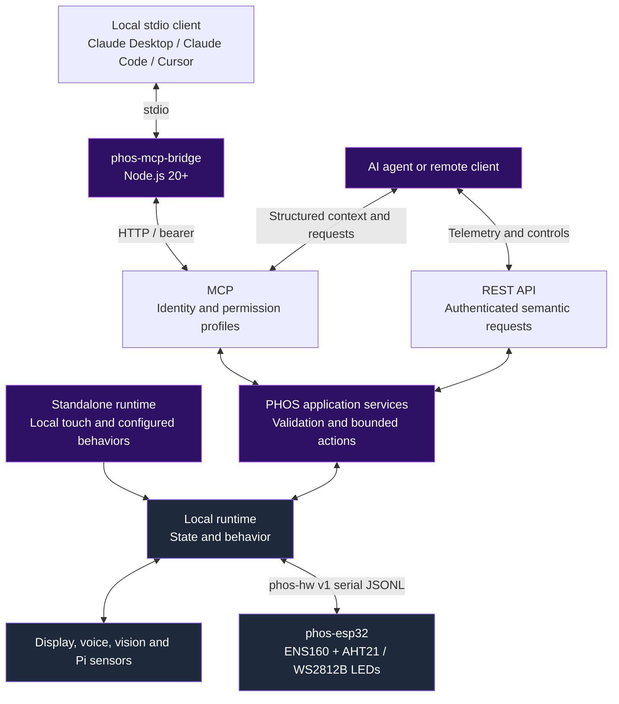

---
hide:
  - toc
classes:
  - phos-home
---

{ .phos-landing-logo width="128" height="128" }

# Build a physical presence for your AI.

PHOS is an open-source Raspberry Pi robot with expressive eyes, optional vision, voice, and sensors. Build a local companion or give an external AI agent permission-controlled physical context through MCP.

[Get Started](build-phos.md){ .md-button .md-button--primary }
[Explore Architecture](architecture.md){ .md-button }

Start with the Raspberry Pi 3 and 5-inch 800×600 display baseline. Follow the
[User Guide](build-phos.md) to install PHOS, configure your hardware, and try
the capabilities you need. Camera, voice, sensors, external controllers, and
Web Admin are opt-in; each guide explains its prerequisites.

## How PHOS works

**Standalone:** run the animated face, supported local touch reactions, and
configured sensor behaviors on the Pi. Add voice capture, speech output, or
local administration when ready. These paths do not require an external agent.

**AI agent-connected:** connect a compatible client through Streamable HTTP
MCP. The agent reads structured observations and requests permitted expression,
speech, state, or signal actions. PHOS authenticates requests, applies its
permission profiles, and owns hardware execution. Reasoning stays with the
external agent; end-to-end conversational LLM operation remains future work.

Both modes use the same runtime and application services. You can start locally
and [connect an agent later](developer-quickstart.md).

## PHOS Ecosystem

| Repository | Role in your build |
| --- | --- |
| [phos](https://github.com/phosairobot/phos) | Raspberry Pi runtime, Vision, Voice, Web Admin, REST API, and the MCP Streamable HTTP server. |
| [phos-mcp-bridge](https://github.com/phosairobot/phos-mcp-bridge) | Recommended Node.js 20+ adapter for local `stdio` clients such as Claude Desktop, Claude Code, and Cursor. |
| [phos-esp32](https://github.com/phosairobot/phos-esp32) | Official `phos-hw` v1 firmware for ENS160 + AHT21 telemetry and ESP32-driven WS2812B LEDs. |

The bridge reads its PHOS bearer from `PHOS_MCP_TOKEN` in the process
environment, never CLI flags, and does not automatically retry `tools/call`.
This avoids replaying a physical action when a response is lost. PHOS remains
responsible for identity, permissions, and semantic decisions. Start with the
[MCP client guide](developer-quickstart.md); use native Streamable HTTP directly
when your client supports it.

## Core capabilities

-   :material-connection: **MCP integration**

    ---

    Share semantic physical context through permission-checked tools and
    Resources. Read bounded RAM-only history or request an authorized camera
    snapshot, without continuous video streaming.

    [Connect an MCP client](mcp-overview.md)

-   :material-api: **REST API**

    ---

    Read status, health, and available sensor data; request supported semantic
    actions through the authenticated API. Explore the supplied OpenAPI and
    Swagger UI documentation.

    [Use the REST API](remote-api.md)

-   :material-cog-outline: **Web administration**

    ---

    Inspect the live status dashboard, configure skins and settings, and manage
    agent access. Apply supported changes through validated live activation,
    reload, or restart paths.

    [Set up Web Admin](web-admin-overview.md)

-   :material-eye-outline: **Vision & presence**

    ---

    Enable Picamera2 face tracking, presence, attention, and expression
    observations. Optional on-demand NanoDet supplies object labels and
    confidence; it requires a separately installed model.

    [Explore vision and expressions](vision-expressions.md)

-   :material-account-voice: **Voice: STT & TTS**

    ---

    Capture bounded speech sessions with Vosk or Cartesia STT. Speak through
    Piper, Cartesia, or ElevenLabs TTS and the separate audio playback path.
    Configure explicit voice command sessions with the supported English/Italian
    vocabulary. Audio hardware, models, and provider setup are required.

    [Configure voice and speech](voice.md)

-   :material-chip: **Sensors & ESP32 hardware**

    ---

    Add BME280/BMP280 environmental readings, MPU6050 motion, or controller-backed
    ENS160/AHT21 telemetry. ESP32 integration uses the serial `phos-hw` v1 JSONL
    protocol with the official [phos-esp32 firmware](https://github.com/phosairobot/phos-esp32).

    [Plan your Hardware BOM](hardware-bom.md) · [Check wiring](hardware.md)

## Choose your path

| Journey | Start here | Next steps |
| --- | --- | --- |
| **Makers & users** | Choose parts from the [Hardware BOM](hardware-bom.md), [build PHOS](build-phos.md), and [install the runtime](installation.md). | Check [hardware](hardware-overview.md), configure [Web Admin](web-administration.md), then connect through [MCP](mcp-overview.md) or [REST](remote-api.md). |
| **Developers & contributors** | Read the [architecture](architecture.md), [decisions](decisions.md), and [testing guide](development.md). | Explore [MCP specifications](mcp.md), the [controller protocol](hardware-controller.md), [provider boundaries](architecture.md#core-principles), and [skin extensions](appearance/creating-skins.md); follow the [contribution guide](contributing.md). |

## Watch PHOS in Action

Explore two English-language demos from the official PHOS channel: live
physical context through MCP and analysis of recent environmental history.

  <figure class="video-card">
    

      <iframe src="https://www.youtube-nocookie.com/embed/FeNdXLksbAA?rel=0" title="How to integrate Raspberry Pi with ChatGPT using MCP" loading="lazy" referrerpolicy="strict-origin-when-cross-origin" allow="encrypted-media; picture-in-picture; fullscreen" allowfullscreen></iframe>
    

    <figcaption>
      <strong>How to integrate Raspberry Pi with ChatGPT using MCP</strong>
      ChatGPT reads available eCO₂, TVOC, temperature, and humidity through MCP without direct hardware access.
    </figcaption>
  </figure>
  <figure class="video-card">
    

      <iframe src="https://www.youtube-nocookie.com/embed/KMd93sneYoE?rel=0" title="Giving AI Agents Access to Real Sensor History | Raspberry Pi + ESP32 + MCP" loading="lazy" referrerpolicy="strict-origin-when-cross-origin" allow="encrypted-media; picture-in-picture; fullscreen" allowfullscreen></iframe>
    

    <figcaption>
      <strong>Giving AI Agents Access to Real Sensor History | Raspberry Pi + ESP32 + MCP</strong>
      An AI agent queries available measurements from a three-hour window of bounded RAM telemetry from ESP32 and Raspberry Pi to analyze trends.
    </figcaption>
  </figure>

[More Videos on @phosairobot](https://www.youtube.com/@phosairobot){ .md-button }

## Follow PHOS and share your build

Find source code, report issues, and share hardware experiences on
[GitHub](https://github.com/phosairobot/phos). A star helps other makers discover
the project. For more development updates, follow
[Instagram](https://www.instagram.com/phosairobot/) and
[X](https://x.com/phosairobot).

For implementation details and planned work, see the
[current implementation state](current-state.md), [roadmap](roadmap.md), and
[release records](releases.md). Verify wiring, power, device compatibility, and
calibration for your own build before enabling optional hardware.
