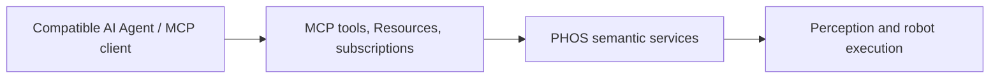
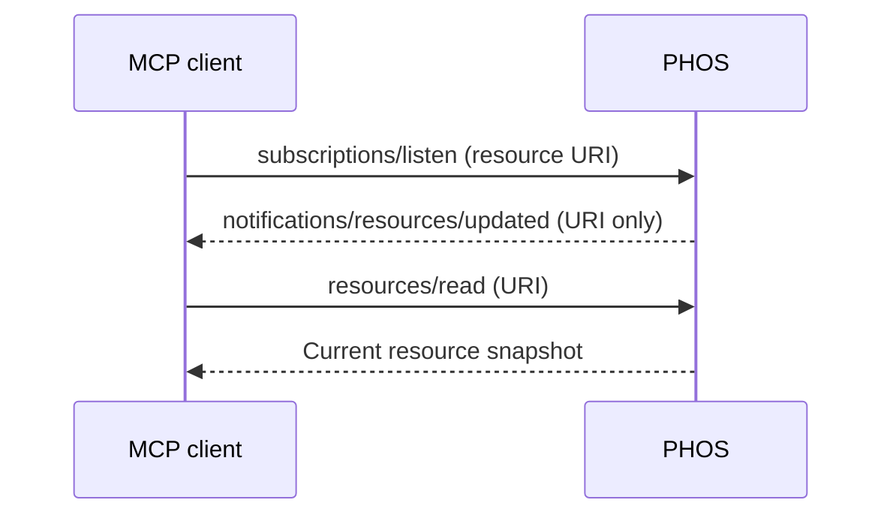

# MCP — Connect AI Agents to PHOS

[Model Context Protocol (MCP)](https://modelcontextprotocol.io/) is an open standard for connecting AI applications with external tools and contextual information. Its [specification](https://modelcontextprotocol.io/specification) defines the protocol; it does not supply intelligence. An AI Agent provides reasoning. PHOS provides bounded physical perception and controlled physical execution.



PHOS can run on its own, but MCP lets a compatible, authenticated agent ask about the robot's current context and request supported actions. PHOS continues to own hardware, robot state, safety boundaries, and permission checks.

## Ask PHOS or request an action

These synchronous interactions return a result to the caller. Availability depends on configured hardware and services; unavailable or degraded capabilities are reported rather than assumed to work.

| Capability | What an agent can do | Interface | Access |
| --- | --- | --- | --- |
| Robot status | Read robot state, available capabilities, and degraded conditions. | `phos_get_status`, `phos://status` | Observer or standard |
| Physical context | Read available environment, air-quality, motion, presence, attention, and observed-expression semantics. | `phos_get_physical_context`, `phos://physical-context` | Observer or standard |
| Environment | Read temperature, humidity where available, pressure, and air-quality indicators with availability/freshness context. | `phos://environment` | Observer or standard |
| Presence and attention | Read whether people are present and the semantic attention state—never identity. | `phos_get_presence`, `phos_get_attention` | Observer or standard |
| Observed expression | Read a bounded visible-expression classification; it is not an emotion or identity claim. | `phos_get_observed_expression` | Observer or standard |
| Physical evidence | Assess retained measurement coverage, freshness, and recovery evidence before interpreting history. | `phos_get_physical_assessment`, `phos://physical-context/assessment` | History permission required |
| Retained context | Query bounded RAM-only measurements or confirmed transitions. | `phos_query_measurements`, `phos_list_physical_transitions` | History permission required |
| Object awareness | Request one on-demand, local NanoDet observation when configured. | `phos_get_visible_objects` | Perception permission required |
| Camera observation | Retrieve a privacy-bounded JPEG from the latest cached frame, or wait for the next pipeline frame, when camera access is permitted. | `phos_get_camera_snapshot`, `phos_capture_camera_snapshot`, `phos://vision/snapshot` | Standard only |
| Expression | Request a supported PHOS expression. | `phos_set_expression` | Standard only |
| Thinking visual state | Request a bounded agent-owned thinking visual state, or release it. | `phos_set_state` | Standard only |
| Voice | Ask PHOS to speak bounded text through configured TTS. | `phos_speak` | Standard only |
| Robot state | Request normal sleep or wake transitions. | `phos_sleep`, `phos_wake` | Standard only |
| Semantic signal | Request a supported, transient user-attention signal. | `phos_signal_user` | Standard only |

An `observer` profile is deliberately read-only. A `standard` profile can use the currently exposed semantic actions and, when camera is available, the protected snapshot Resource. PHOS checks permissions on every authenticated request; a client never receives direct GPIO, serial-controller, or renderer access. See the [MCP reference](mcp.md) for the exact endpoint, authentication, and credential lifecycle.

## Tool and Resource Catalog

All tools return structured semantic results; tools without arguments take `{}`.

| Tool | Arguments | Access | Purpose / limit |
| --- | --- | --- | --- |
| `phos_get_status`, `phos_get_physical_context`, `phos_get_presence`, `phos_get_attention`, `phos_get_observed_expression` | None | Observer, standard | Read compact semantic state. Attention never includes a target identity. |
| `phos_get_physical_assessment` | None | `read_physical_history` | Assess bounded evidence; it does not classify trends or prove sensor accuracy. |
| `phos_query_measurements` | required `metric`; optional time range and limit | `read_physical_history` | Read retained samples and summaries; history is RAM-only. |
| `phos_list_physical_transitions` | optional event type and limit | `read_physical_history` | Read bounded confirmed semantic transitions. |
| `phos_get_visible_objects` | None | `read_perception` | One on-demand NanoDet observation; labels/confidence only. |
| `phos_get_camera_snapshot` | None | Standard | Returns the existing cached JPEG; PHOS does not interpret it. |
| `phos_capture_camera_snapshot` | None | Standard | Waits for the next Vision frame; this is not a separate camera exposure. |
| `phos_set_expression` | required `expression` | Standard | Requests a supported expression. |
| `phos_set_state` | required `state`; optional `duration_ms` | Standard | `thinking` is bounded; `idle` releases the caller's lease. |
| `phos_speak` | required `text` (1–500 characters) | Standard | Requests bounded TTS; physical side effect. |
| `phos_sleep`, `phos_wake` | None | Standard | Request normal robot-state transitions; physical side effect. |
| `phos_signal_user` | required `signal` | Standard | Requests a supported transient signal; physical side effect. |

| Resource | Access and use | Update cue |
| --- | --- | --- |
| `phos://status` | Observer/standard compact robot status. | Yes |
| `phos://physical-context` | Observer/standard anonymous environment, motion, presence, attention, and observed expression. | Yes |
| `phos://physical-context/assessment` | History permission required; bounded evidence and source availability. | Yes |
| `phos://environment` | Observer/standard environmental context. | Yes |
| `phos://vision/snapshot` | Standard-only cached JPEG for external multimodal interpretation. | No — intentionally on-demand. |

Use `resources/read` with the URI. Camera images are separate from notification delivery and may contain people visible to the camera.

## React to changes

MCP resource subscriptions provide asynchronous *change cues*, not long-running tool jobs and not unsolicited chat messages. A subscribing client decides what to do after it is notified.

```text
Subscribe → PHOS state changes → resource update notification → agent refreshes Resource
```

The verified subscribable update targets are:

- `phos://status` for robot-state, capability, and system-health changes.
- `phos://physical-context` for robot-state plus relevant environment, air-quality, motion, presence, attention, and observed-expression changes.
- `phos://environment` for relevant environmental condition or availability changes.
- `phos://physical-context/assessment` for relevant environmental or air-quality
  condition and availability changes.

PHOS coalesces repeated update cues. The client rereads the updated Resource to obtain current data. `phos://vision/snapshot` is readable by authorized clients, but PHOS does not publish subscription updates for it. The separately owned Streamable-HTTP bridge forwards the supported MCP subscription path and can reconnect upstream; client behavior after a disconnection remains the client's responsibility.

Presence and attention are delivered through the same anonymous
`phos://physical-context` cue. A client must re-read it to see the current
presence state/count/confidence and semantic attention state; PHOS does not
send identities, tracking IDs, or camera images in a notification. These cues
are best-effort and have no history: after reconnecting, subscribe again and
read the current Resource. They do not automatically make any external AI
agent reason or act.

MCP Events is a distinct, future optional protocol capability. PHOS does not
advertise or implement it today because its current Python MCP SDK lacks native
typed support. This does not affect standard MCP clients or Resource
subscriptions.



The cue does not identify the internal transition that caused it or include an
event payload. It is best-effort: adjacent identical semantic transitions can
be deduplicated, resource cues can be coalesced, slow clients can lose their
bounded stream, and there is no exactly-once delivery, history, or replay.

### Internal semantic transition mapping

These are not independent MCP subscriptions; clients subscribe by URI and
re-read the current state.

| Internal transition | Notified Resource(s) |
| --- | --- |
| `robot_state_changed` | status, physical-context |
| `environment_condition_changed` | environment, physical-context |
| `air_quality_condition_changed`, `motion_state_changed`, `presence_changed`, `attention_changed`, `observed_expression_changed` | physical-context |
| `capability_changed`, `system_health_changed` | status |
| `environment_availability_changed` | environment, physical-context |
| `air_quality_availability_changed`, `motion_availability_changed` | physical-context |

`PERSON_ENTERED`, `PERSON_LEFT`, attention-target lifecycle events, touch,
voice, and raw Vision events are not independently subscribable through MCP.

In short: **synchronous** means “what is PHOS's current state?”; **asynchronous** means “notify my agent when this selected PHOS state changes.”

## Practical ways to use MCP

### Environmental awareness

PHOS provides fresh, availability-aware environmental observations. The agent uses those observations in its own reasoning or response. This is synchronous; it requires the relevant configured sensors and read permission.

### A physical voice for an agent

PHOS provides speech and a supported expression request. The agent decides what to say and when to use it. This is synchronous and requires a `standard` agent, a working configured TTS path, and the requested supported expression.

### Presence-aware assistance

PHOS provides presence and attention semantics without identifying people. The agent decides whether a response is appropriate. This is synchronous and requires the optional vision pipeline plus read permission.

### Reactive state monitoring

PHOS provides Resource update cues when state changes, such as sleep or wake. The agent subscribes, refreshes the notified Resource, and decides its next step. This is asynchronous and depends on MCP client subscription support.

### Camera-assisted observation

PHOS provides an authorized current snapshot. The agent performs any further visual interpretation. This is synchronous, requires camera availability, and is restricted to the `standard` profile.

## Get started

1. Configure and start PHOS's trusted-local Streamable HTTP MCP endpoint.
2. Create an agent and credential in **Settings → Agents** when credential mode is enabled.
3. Connect a compatible client to the endpoint and provide the bearer through its safe credential mechanism.
4. Start with status or physical context, then request only capabilities your configured agent is allowed to use.

For connection details, profiles, bearer handling, full tool/resource contracts,
remote HTTPS-tunnel guidance, and security considerations for anonymous access,
continue to the [technical MCP reference](mcp.md#mcp-authentication-security).

## Testing PHOS MCP with MCP Inspector

Use Inspector for discovery, `tools/list`, `tools/call`, `resources/list`, and
`resources/read`; select Streamable HTTP and use the configured endpoint (the
default is `http://127.0.0.1:8001/mcp`). Supply a bearer only through its secure
credential/header mechanism when bearer mode is configured. From a Mac, tunnel
first: `ssh -L 8001:127.0.0.1:8001 pi@PHOS_HOST`.

Read status, physical context, and environment; a standard agent may also read
the snapshot JPEG. Test sleep/wake only with deliberate authorization. Inspector
versions vary in support for modern long-lived `subscriptions/listen`; if yours
does not expose it, use Inspector for tools/resources and the repository's
Python MCP integration test as the transport reference. A compatible client
keeps this request open:

```json
{"jsonrpc":"2.0","id":"listen-1","method":"subscriptions/listen","params":{"notifications":{"resourceSubscriptions":["phos://physical-context"]}}}
```

On a stable presence or attention transition it receives
`notifications/resources/updated` with only
`{"uri":"phos://physical-context"}`, then reads that URI again. After a
disconnect, reconnect, resubscribe, and read current state; do not expect
historical notifications.
