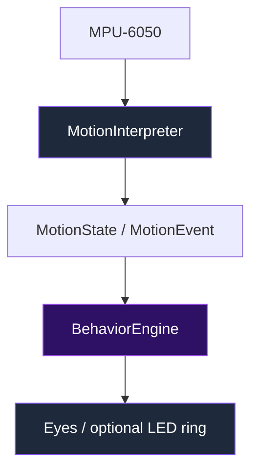

# Motion awareness

Motion is interpreted as a confirmed event, not treated as a direct renderer or
GPIO command.

## Motion as semantics

The optional GY-521/MPU-6050 service reads acceleration and angular velocity;
it does not send raw values to the renderer or GPIO. `MotionInterpreter` turns
fresh samples into confirmed semantic states: **STILL**, **MOVING**,
**TILT_LEFT**, **TILT_RIGHT**, **TILT_FORWARD**, **TILT_BACK**, **SHAKE** and
**IMPACT**.

## Visual reactions

-   :material-eye-outline: **Directional tilt**

    ---

    Tilt produces directional pupil intent and eye asymmetry.

-   :material-led-on: **Optional LED feedback**

    ---

    The optional WS2812B ring can show progressive directional fill animations.

-   :material-alert-outline: **Shake & impact**

    ---

    Shake and impact create short alert intent.

!!! info "Temporary visual overrides"

    These reactions do not rewrite the configured base source. The currently
    resolved persistent visual state returns after the effect expires.

## Hardware validation

!!! warning "Check the physical installation"

    Check the board wiring and mounting axes, then verify the configured tilt
    directions and visual reactions on the Pi.

Details belong in the [canonical hardware guide](hardware.md#gy-521-mpu-6050)
and [architecture reference](architecture.md#motion-interpretation-extension).
