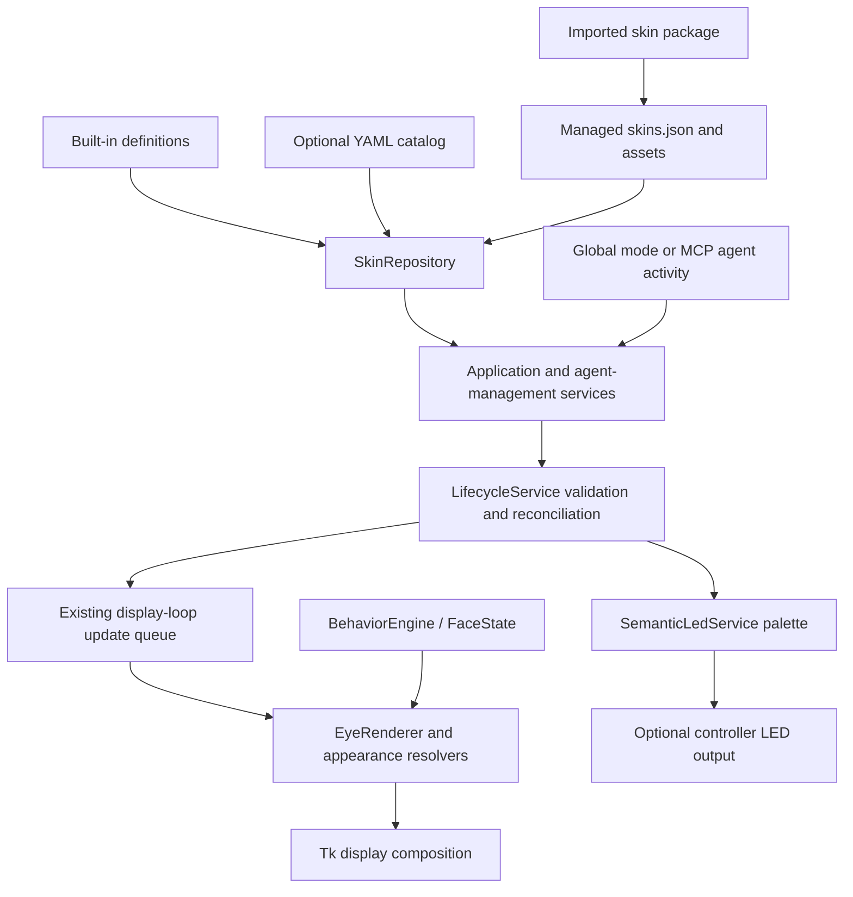

# Skin Architecture

Skins reuse the existing appearance configuration, lifecycle services, render
loop, and semantic LED arbitration. They are declarative data, not executable
renderer plugins.

## Discovery and loading

**`SkinRepository`** combines three sources in order:

1. **Built-ins** returned by `built_in_skins()`.
2. **Optional YAML catalog** selected by `appearance.config_file`, resolved
   beneath the active PHOS configuration directory.
3. **Managed custom skins** persisted in `skins.json` beside that configuration.

The catalog resolves inheritance from another catalog entry or a built-in,
merges partial appearance overrides, validates the resolved definition, and
checks its referenced backgrounds. IDs must be unique across all sources.
Cycles, unknown parents, excessive inheritance depth, invalid YAML/JSON, and
conflicting IDs raise configuration errors; the list does not silently discard
bad definitions.

Portable packages are imported into managed storage before appearing in this
list. Import assigns a new `custom-<uuid-hex>` ID, rewrites background references,
and saves metadata atomically. The package does not execute code or fetch assets
from a URL. See [structure and limits](structure.md).

## From selection to a rendered frame

- **`PhosApplicationService`** lists, imports, exports, previews, applies, and
  deletes skins through the shared application boundary.
- **`AgentManagementService`** resolves global or selected-agent appearance and
  its Physical Personality/LED palette without persisting temporary ownership.
- **`LifecycleService`** validates `RuntimeConfig`, applies supported visual
  changes, and reconciles the effective skin.
- **`EyeRenderLoop`** queues appearance updates onto the existing display loop.
- **`EyeRenderer`** consumes `FaceState` and validated iris/shape configuration.
  It interpolates visual targets while existing blink and expression logic run.
- **Background, Eye Safe, and State Effect resolvers** select presentation for
  the effective state; they do not make behavior decisions.
- **`SemanticLedService`** uses eligible theme colours while preserving runtime
  priority, animation parameters, controller availability, and protected colours.

## Display composition

The Tk adapter composes the existing layers in this order:

1. State background.
2. Eye Safe Layer.
3. State Effects.
4. Animated eyes.
5. Environmental decorations.
6. Optional local camera preview.
7. Transient semantic notice.
8. Protected local Admin/recovery overlay.

Backgrounds are prepared and cached for a path/display-size combination. The
image is proportionally scaled to fill the display and centre-cropped; it is not
stretched. Decode failure falls back to the renderer's background and is logged.
Skin packages cannot replace the protected overlays or assign arbitrary drawing
code to these layers.

## Preview, apply, and active-agent selection

**Live Preview** applies the four appearance blocks temporarily without saving
or replacing the active configuration snapshot. It does not apply the skin's
LED palette or Physical Personality. It has no automatic expiry timer; a later
appearance application, reconciliation, or restart can replace it.

**Apply** builds and validates a complete configuration, saves appearance fields
and `appearance.global_skin_id`, then requests reload. On failure the application
attempts to restore the previous saved configuration. This is not a guarantee
that every already-applied live subsystem change is rolled back; inspect runtime
status after a failure.

**Automatic reconciliation** resolves the persisted global skin or the eligible
active agent's assigned skin, applies visual settings through lifecycle, then
applies Physical Personality and the effective LED palette. Unchanged resolved
appearance is not repeatedly reapplied.

In `follow_agent` mode, accepted semantic MCP work renews the registered
identity's activity lease. Authentication alone, denied work, and transport
keepalives do not renew it. The highest-priority eligible active agent wins. On
a tie PHOS retains the previous winner if possible; otherwise it selects a
stable agent-ID order. Expiry returns selection to another eligible agent or the
global fallback. This does not grant exclusive ownership of physical outputs.

## Fallback and failure handling

- Missing managed custom backgrounds are reported by state. Explicit live
  Preview/Apply can omit those assignments while retaining the stored skin.
- Automatic selection of a skin with missing backgrounds falls back to global
  appearance rather than partially applying that agent skin.
- An unavailable persisted global skin retains the saved display configuration
  and uses `analytical` Physical Personality.
- Omitted eye shape resolves to `classic_oval`; omitted Physical Personality
  resolves to `analytical` during reconciliation.
- Missing, disabled, or partial LED palettes use canonical fallback colours for
  unprovided intents; warning/error retain protected colours.
- Missing runtime appliers reject live activation. Corrupt catalogs or custom
  metadata can make the catalog unavailable until repaired.

The [troubleshooting guide](troubleshooting.md) distinguishes these designed
fallbacks from current importer, snapshot, and static-preview limitations.
