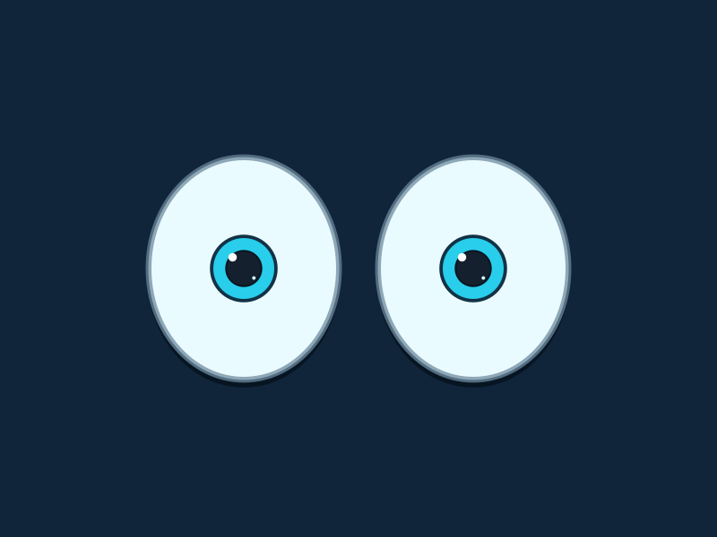
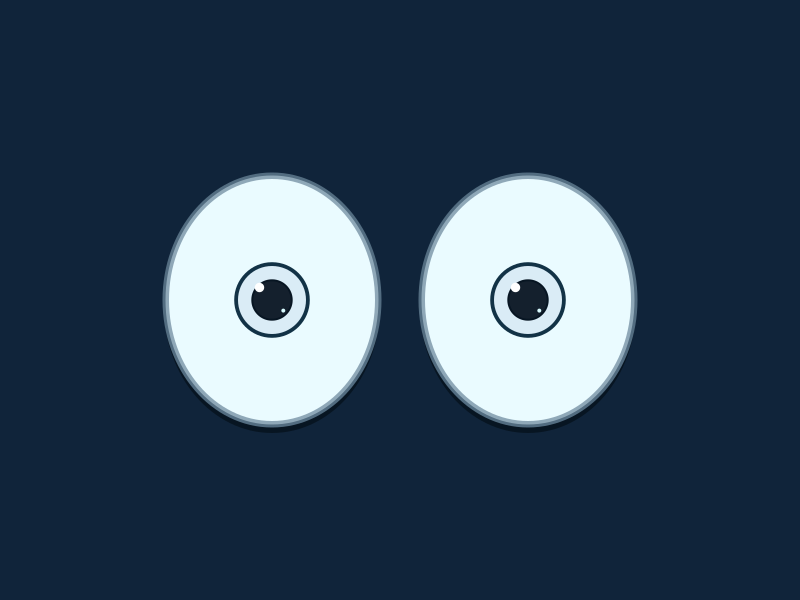
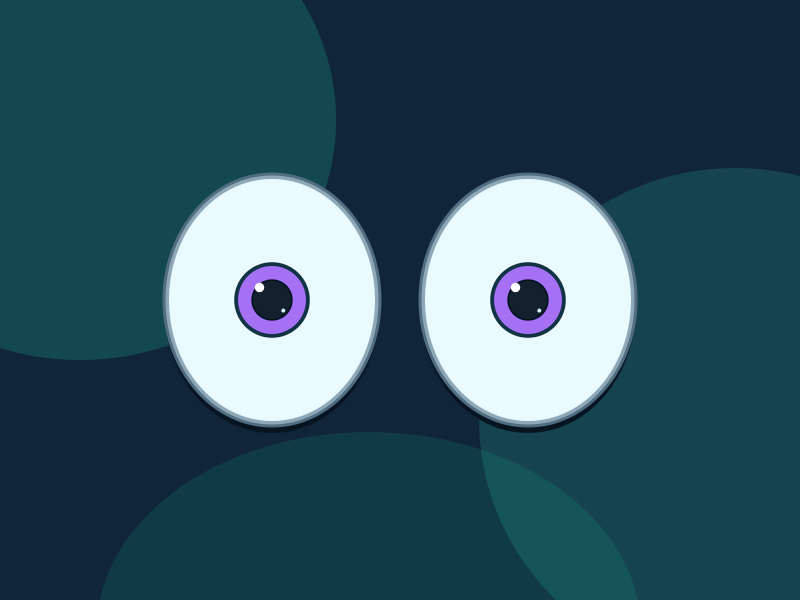
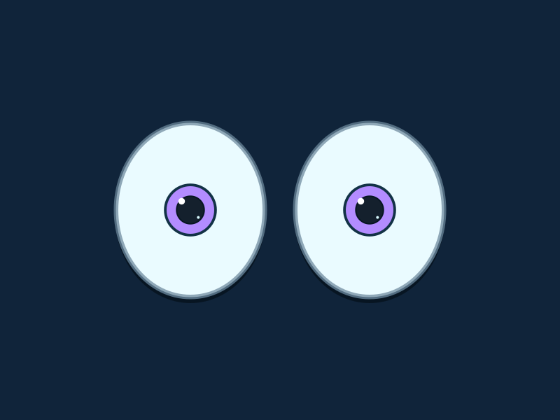

# Built-in Skins

PHOS defines three built-in skins in `robot.ui.skins.built_in_skins()`. They
require no skin directory or background images and cannot be deleted or edited
as built-ins. Export one to create an independent custom package.

The repository also supplies **Aurora** through `config/skins.yaml`. It is a
catalog skin, not a fourth code-defined built-in; it appears when that catalog
is configured and available.

## Compare the supplied appearances

| Name / ID | Iris and shape | Eye Safe Layer | State Effects | Physical Personality |
| --- | --- | --- | --- | --- |
| **PHOS Default** / `phos-default` | Cyan `#28CEEB`; `classic_oval` | Enabled, `balanced` | Disabled; `balanced`, `phos`, reduced motion off | Omitted; effective fallback `analytical` |
| **Minimal** / `minimal` | White `#DAECF6`; `classic_oval` | Enabled, `subtle` | Disabled; `balanced`, `phos`, reduced motion off | Omitted; effective fallback `analytical` |
| **Ambient** / `ambient` | Violet `#A670F5`; `classic_oval` | Enabled, `balanced` | Enabled; `balanced`, `aqua`, reduced motion off | Omitted; effective fallback `analytical` |
| **Aurora** / `aurora` | Custom violet `#B38CFF`; inherited `classic_oval` | Inherited enabled, `balanced` | Inherited disabled; `balanced`, `phos`, reduced motion off | Explicit `calm` |

All four have backgrounds disabled and all six background assignments `null`.
With no usable background image, the Eye Safe Layer has no image to analyse and
does not add a halo. Minimal reduces visual complexity; it does not enable the
State Effects reduced-motion option or disable normal blinking.

## PHOS Default

“The standard PHOS appearance.” Cyan irises and the classic oval profile retain
the baseline appearance. There is no skin LED palette, so semantic LED colours
fall back to the runtime defaults.

## Minimal

“Reduced visual complexity.” White irises and the subtle Eye Safe Layer setting
provide an alternative baseline without backgrounds or State Effects. There is
no skin LED palette.

## Ambient

“A calm PHOS effect palette.” Violet irises and enabled aqua State Effects add
the built-in state treatments. The description refers to its visual palette;
Ambient does not select the `calm` Physical Personality preset.

Ambient also supplies these optional semantic LED colours:

| Intent | Colour |
| --- | --- |
| `idle` | `#38BDF8` |
| `listening` | `#22D3EE` |
| `thinking` | `#818CF8` |
| `speaking` | `#60A5FA` |
| `sleeping` | `#1E3A8A` |
| `ambient` | `#F59E0B` |

`success` and `attention` are omitted and use runtime fallback colours. Warning
and error are not themeable. An active, LED-capable controller is required for
physical LED output; selecting Ambient alone does not enable hardware.

## Aurora: the supplied catalog example

Aurora inherits `phos-default`, replaces only its iris colour, and selects
`calm` idle timing. The complete shipped entry is shown in
[Skin Structure](structure.md#the-shipped-catalog).

These images are static 800×600 neutral/idle SVGs generated through PHOS's
existing `render_preview` function. They are not recordings of animation and
do not illustrate Physical Personality timing. Use the running face display to
assess transitions and idle behavior.

## Customise a supplied skin

Use **Appearance → Skins → Export**, edit the exported package, and import it as
a new custom skin. Package fields and accepted values are listed in the
[configuration reference](configuration.md). For Aurora, edit or inherit its
catalog entry instead; the Web Admin does not provide an editor for catalog
YAML. Follow [Creating a Custom Skin](../appearance/creating-skins.md) for a
complete working example.
