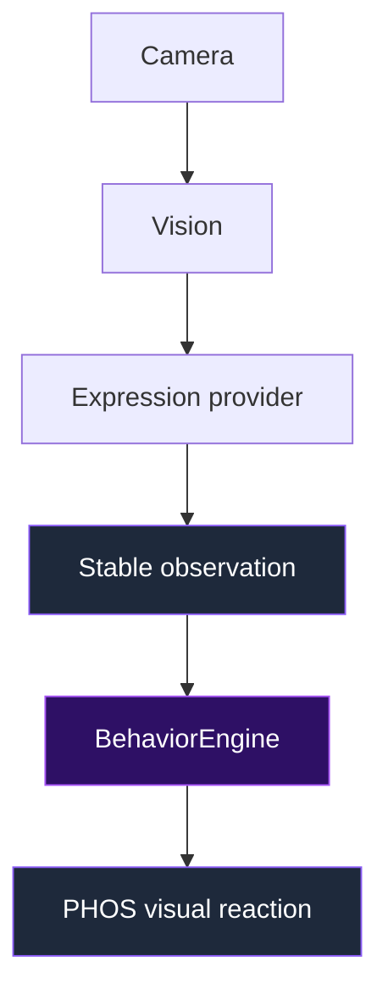

# Vision & expressions

PHOS turns camera evidence into a stable semantic observation before behavior
chooses a visual response. It does not mechanically mirror a person.

## Observe, then respond

PHOS uses the Raspberry Pi Camera to detect, select and track a face. The
selected face position becomes bounded pupil/gaze intent; face tracking and
expression inference have independent cadences.

!!! info "Visible expression, not internal emotion"

    Expression labels are uncertain observations of a person’s **visible facial
    expression**. They are not claims about that person’s internal state, and they
    are never treated as PHOS’s own emotion. `BehaviorEngine` chooses PHOS’s subtle
    response only after temporal confirmation.

## Stable observations and reactions

| Stable observation                   | PHOS reaction                                       |
| ------------------------------------ | --------------------------------------------------- |
| Neutral                              | Calm acknowledgement when enabled after calibration |
| Happy                                | Warm, friendly visual response                      |
| Surprised                            | Temporary alert/open response with cooldown         |
| Unknown or rejected negative classes | Preserve/decay toward baseline; no negative mimicry |

## Expression providers

-   :material-chip: **Local ONNX**

    ---

    The default selectable expression path uses a local ONNX model behind
    the expression-provider contract.

-   :material-cloud-outline: **Optional AWS Rekognition**

    ---

    AWS uses the same provider contract. Selected crops leave the Pi only when
    this mode is enabled; there is no automatic fallback.

!!! warning "Validate expression accuracy"

    Both modes require physical validation before accuracy claims can be made.

## Next steps

Read the [canonical Vision reference](vision.md) for crop, smoothing, provider,
privacy and calibration details.
