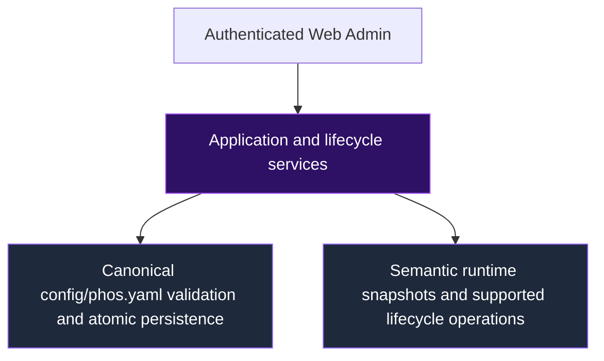

# Web Admin

Web Admin is PHOS’s optional, single-administrator configuration editor for a
trusted LAN. Configure the robot and inspect its semantic runtime status through
the shared application and lifecycle services.

## Configure with boundaries

Web Admin uses the same canonical `config/phos.yaml` model, validation and
atomic persistence as startup. It does not access the camera, hardware drivers
or renderer directly.

## First access and safety

When enabled, browse to the configured Pi address. The bootstrap password is
`phos`, must be changed on first login, and there is no username. Password
hashes live outside runtime JSON; sessions expire and all forms use CSRF
protection.

!!! warning "Trusted LAN access"

    Web Admin uses HTTP for a trusted LAN. It is not a public Internet service.

## Configuration domains

The sidebar exposes Dashboard, PHOS Status, Controls, Sensors, API, Diagnostics,
System Actions and focused Settings pages.

-   :material-monitor-dashboard: **Dashboard & status**

    ---

    Inspect semantic runtime snapshots. Status does not claim live hardware
    health or probe AWS credentials.

-   :material-tune: **Runtime controls**

    ---

    Controls is the only writable runtime action page. Robot State, Expression,
    Visual Source and Overlay appear as separate, responsive cards.

-   :material-stethoscope: **Diagnostics**

    ---

    Compare saved and active configuration, including differences that require
    reload or restart.

-   :material-cog-outline: **System actions**

    ---

    Use only the supported lifecycle operations. Focused Settings pages edit
    the canonical configuration domains.

## Live runtime dashboard

Dashboard, PHOS Status and Sensors show a current semantic snapshot, then keep
it updated through the authenticated Remote API event stream. The default
Waitress deployment uses Server-Sent Events at `/api/v1/events` (rather than a
WebSocket upgrade), preserving the same application-service event contract.
The connection indicator reports connected, reconnecting or disconnected. Last
valid values remain visible while reconnecting; a bounded reconnect backoff uses
a conservative 30-second snapshot fallback and always obtains a fresh snapshot
after reconnection.

The Sensors dashboard presents each optional BMP280/environmental sensor,
controller-backed ENS160/AHT21 and MPU6050 independently, including freshness and unavailable, stale,
warming-up or degraded conditions. It displays PHOS's interpreted environment,
motion, visual source and overlay intent without reimplementing sensor
interpreters in the browser. Runtime controls and overlay choices are populated
from Remote API capabilities on Controls, not browser-maintained enum lists.

The Sensors view presents canonical controller-backed `sensors.ens160` and
`sensors.aht21` records: ENS160 estimated eCO2, TVOC, AQI-UBA, validity and
compensation; AHT21 controller-provenance temperature/humidity. BMP280/BME280
ambient readings remain separate, and unusable historic values are not shown
as current.

The same read-only status cards show face-display touch telemetry: enabled
state, the last completed semantic gesture, position, normalized position,
duration and timestamp. Raw pointer input is neither retained nor streamed.

## Save, reload, restart

| Operation | Effect |
| --- | --- |
| **Save** | Validates and atomically persists the complete active configuration file; it does not change the running process. |
| **Reload configuration** | Can apply logging level, iris appearance, legacy LED-ring visual settings and camera-preview settings. Configure the ESP32 ring through [Hardware Controller](hardware-controller.md#ws2812b-ring-connection). Other valid changes remain explicitly restart-required. |
| **Restart PHOS** | Available only through the managed user systemd service, with confirmation. It never reboots the Pi. |

## Next steps

Use the [canonical Web Admin manual](web-administration.md) for the full domain
map, recovery steps and security limits.
